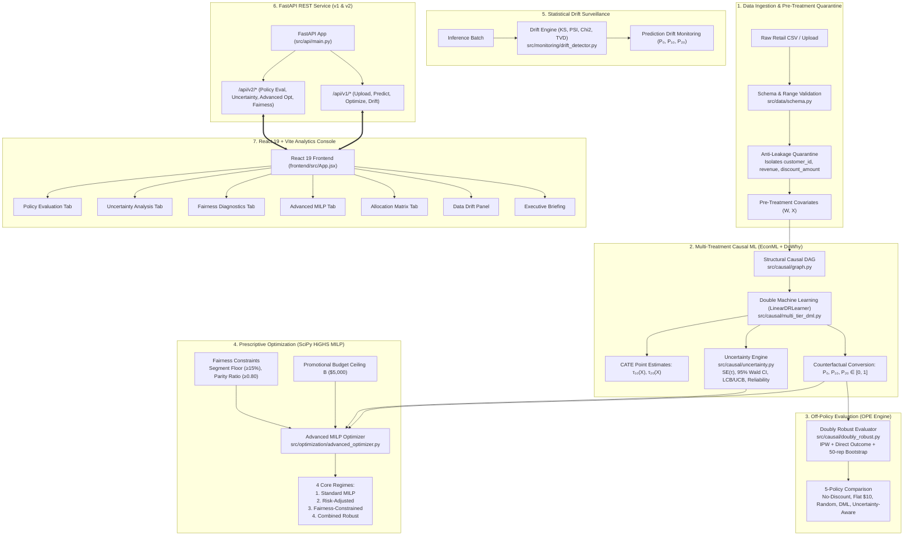

# EconoCasual 2.0: Causal Machine Learning & Prescriptive Pricing Optimization

[](https://github.com/tanmay0212-cls/EconoCasual/actions/workflows/tests.yml)
[](https://www.python.org/)
[](https://econml.azurewebsites.net/)
[](https://py-why.github.io/dowhy/)
[](https://scipy.org/)
[](https://react.dev/)
[-brightgreen)](https://github.com/tanmay0212-cls/EconoCasual)
[](https://fastapi.tiangolo.com/)

> **Production-grade Causal Machine Learning, Doubly Robust Off-Policy Evaluation, CATE Uncertainty Quantification, and Risk-Adjusted / Fairness-Constrained Prescriptive Knapsack Optimization for Promotional Pricing.**

---

## Executive Summary

In retail and e-commerce, offering promotional discount codes is a high-stakes lever to drive customer acquisition and incremental conversion. However, standard observational transaction logs suffer from severe **marketing selection bias (confounding)**: high-loyalty, high-frequency customers receive promotions disproportionately. Supervised regression and unadjusted classification mistake correlation for causation, generating inflated elasticity estimates that squander promotional budgets on customers who would have purchased at full price.

**EconoCasual 2.0** solves this with an end-to-end causal decision pipeline:
1. **Structural Causal DAGs (DoWhy):** Back-door criterion identification isolating strictly pre-treatment confounders $W$ and quarantining mediators (`discount_amount`) and post-treatment outcomes (`revenue`).
2. **Multi-Tier Double Machine Learning (EconML):** Chernozhukov et al. (2018) orthogonalized cross-fitting to estimate heterogeneous treatment effects across multiple discount tiers ($0, $10, $20).
3. **Doubly Robust Off-Policy Evaluation (OPE):** Evaluates multi-treatment counterfactual policies combining propensity score inverse weighting (IPW) and direct outcome modeling with 50-sample bootstrap confidence intervals.
4. **CATE Uncertainty Quantification:** Valid standard errors, asymptotic 95% Wald and conservative lower confidence bounds (LCB), and empirical coverage evaluated against ground-truth data-generating processes (95.52% for $10, 95.34% for $20).
5. **Risk-Adjusted & Fairness-Constrained Prescriptive MILP (SciPy HiGHS):** Mixed-Integer Linear Programming knapsack allocation optimizing expected profit under marketing budget caps, downside variance penalty ($\lambda \cdot \sigma$), and business segment parity floors.
6. **Continuous Drift Surveillance:** Two-sample Kolmogorov-Smirnov, PSI, Wasserstein, and counterfactual prediction drift monitoring ($P_0, P_{10}, P_{20}$).
7. **Full-Stack Console:** Modern FastAPI REST API (`/api/v1` and `/api/v2`) paired with an interactive React 19 dashboard featuring 8 live consoles, KPI scorecards, and strategy benchmarks.

---

## Table of Contents

1. [Causal Identification & Anti-Leakage Quarantine](#1-causal-identification--anti-leakage-quarantine)
2. [End-to-End System Architecture](#2-end-to-end-system-architecture)
3. [Mathematical Formulations](#3-mathematical-formulations)
   - [3.1 Multi-Treatment Double Machine Learning](#31-multi-treatment-double-machine-learning)
   - [3.2 Doubly Robust Off-Policy Evaluation](#32-doubly-robust-off-policy-evaluation)
   - [3.3 CATE Uncertainty Quantification](#33-cate-uncertainty-quantification)
   - [3.4 Risk-Adjusted & Fairness-Constrained Prescriptive MILP](#34-risk-adjusted--fairness-constrained-prescriptive-milp)
4. [Empirical Results & Benchmark Scorecards](#4-empirical-results--benchmark-scorecards)
   - [4.1 Multi-Policy Doubly Robust OPE Evaluation](#41-multi-policy-doubly-robust-ope-evaluation)
   - [4.2 Four Core Optimization Regimes Comparison](#42-four-core-optimization-regimes-comparison)
   - [4.3 Optimization Scale Benchmark](#43-optimization-scale-benchmark)
5. [FastAPI REST API Specification](#5-fastapi-rest-api-specification)
6. [Interactive React 19 Dashboard](#6-interactive-react-19-dashboard)
7. [Repository Structure](#7-repository-structure)
8. [Installation & Quickstart Guide](#8-installation--quickstart-guide)
9. [Automated Testing & Audit Verification](#9-automated-testing--audit-verification)
10. [Causal Assumptions, Governance & Safeguards](#10-causal-assumptions-governance--safeguards)

---

## 1. Causal Identification & Anti-Leakage Quarantine

### 1.1 Structural Causal Directed Acyclic Graph (DAG)

```text
       [prior_purchases]       [prior_spend]       [engagement_score]
              \                     |                     /
               \                    |                    /
                +---> [discount_offered] (Treatment: $0, $10, $20) <--+
                |             |             |
[customer_tenure]             |             +---> [discount_amount] (Mediator)
                |             v                          \
                +-----> [purchased] (Outcome: Y ∈ {0,1}) <+
              /               |                            \
    [campaign_channel]        +-----------------------------> [revenue] (Post-Treatment)
```

### 1.2 Approved Back-Door Adjustment Set ($W$)
Under Pearl's Back-Door Criterion, the average treatment effect of `discount_offered` on `purchased` is identified by conditioning on the pre-treatment confounder set:
$$W = \{\text{prior\_purchases}, \text{prior\_spend}, \text{engagement\_score}, \text{customer\_tenure}, \text{campaign\_channel}\}$$

### 1.3 Strict Anti-Leakage Quarantine
* **`discount_amount`:** Post-treatment mediator ($T \to M \to Y$). Conditioning on discount amount mutes the direct mechanism and induces collider stratification bias.
* **`revenue`:** Post-treatment downstream outcome ($Y \to \text{revenue}$). Conditioning on revenue conditions on the future and corrupts conversion probability.
* **`customer_id`:** Identifier. Quarantined from all feature matrices to eliminate memorization and high-cardinality leakage.

---

## 2. End-to-End System Architecture



---

## 3. Mathematical Formulations

### 3.1 Multi-Treatment Double Machine Learning
For customer $i$, let $T_i \in \{0, 10, 20\}$ denote discount assignment and $Y_i \in \{0, 1\}$ denote conversion. Using Neyman-orthogonalized cross-fitting:
$$Y - \mathbb{E}[Y \mid W] = \sum_{d \in \{10, 20\}} \tau_d(X) \cdot \big(\mathbf{1}(T = d) - \mathbb{P}(T = d \mid W)\big) + \varepsilon, \quad \mathbb{E}[\varepsilon \mid X, W] = 0$$

First-stage nuisance models $\hat{g}(W) = \mathbb{E}[Y \mid W]$ and generalized propensity models $\hat{e}_d(W) = \mathbb{P}(T=d \mid W)$ are fit using out-of-fold partitions. The second stage estimates heterogeneous treatment effects $\hat{\tau}_{10}(X)$ and $\hat{\tau}_{20}(X)$ relative to the organic baseline ($0).

Counterfactual conversion probabilities are recovered via:
$$\hat{P}(Y=1 \mid X_i, d) = \text{clip}\big(\hat{P}_0(X_i) + \hat{\tau}_d(X_i), \, 0, \, 1\big)$$

### 3.2 Doubly Robust Off-Policy Evaluation
For any evaluated assignment policy $\pi(d \mid X)$ evaluated on held-out observational data $(X_i, W_i, T_i, Y_i)_{i=1}^N$:
$$\hat{V}_{\text{DR}}(\pi) = \frac{1}{N} \sum_{i=1}^N \left( \sum_{d \in \{0, 10, 20\}} \pi(d \mid X_i) \hat{\mu}_d(X_i) + \frac{\mathbf{1}(T_i = d_{\pi}(X_i))}{\hat{e}(d_{\pi}(X_i) \mid W_i)} \left( Y_i - \hat{\mu}_{d_{\pi}(X_i)}(X_i) \right) \right)$$
where $\hat{\mu}_d(X)$ is the direct outcome model and $\hat{e}(d \mid W)$ is the generalized propensity score with clipping $\hat{e} \ge 0.01$ to prevent extreme propensity inflation. If either the outcome model $\hat{\mu}_d$ or the propensity model $\hat{e}_d$ is correctly specified, the estimator remains unbiased and achieves the semiparametric efficiency bound.

### 3.3 CATE Uncertainty Quantification
For each treatment contrast $d \in \{10, 20\}$, individual treatment effect uncertainty is quantified via:
$$\text{SE}(\hat{\tau}_{d,i}) = \sigma_{\tau, d} \sqrt{1 + h(X_i)}$$
$$\text{CI}_{95\%}(\hat{\tau}_{d,i}) = \left[ \hat{\tau}_{d,i} - 1.96 \cdot \text{SE}(\hat{\tau}_{d,i}), \quad \hat{\tau}_{d,i} + 1.96 \cdot \text{SE}(\hat{\tau}_{d,i}) \right]$$
where $h(X_i) = \frac{1}{2} (X_i - \bar{X})^\top \hat{\Sigma}_X^{-1} (X_i - \bar{X})$ represents Mahalanobis covariate extremity. A customer is flagged as high-reliability when $\text{SE}(\hat{\tau}_{d,i}) \le 0.05$ and the Wald CI excludes zero.

### 3.4 Risk-Adjusted & Fairness-Constrained Prescriptive MILP
Decision variables: binary indicator $x_{i,d} \in \{0, 1\}$ assigning customer $i$ to discount tier $d \in \{0, 10, 20\}$.

#### Objective Function:
$$\max_{\{x_{i,d}\}} \sum_{i=1}^N \sum_{d \in \{0, 10, 20\}} \Big( \pi_{i,d} - \lambda \cdot (m_i V_i - d) \cdot \text{SE}(\hat{\tau}_{i,d}) \Big) x_{i,d}$$
where:
* $\pi_{i,d} = \hat{P}(Y=1 \mid X_i, d) \cdot (m_i V_i - d)$ is the expected economic net profit.
* $\lambda \ge 0$ is the risk-aversion parameter penalizing CATE estimation variance in monetary profit terms. Setting $\lambda = 0$ reduces to the standard expected-profit formulation; setting $\lambda = 1.96$ yields conservative lower-confidence-bound (LCB) optimization.

#### Constraints:
1. **Mutually Exclusive Assignment:** Exactly one discount tier per customer:
   $$\sum_{d \in \{0, 10, 20\}} x_{i,d} = 1 \quad \forall i \in \{1, \dots, N\}$$
2. **Promotional Budget Cap ($B = \$5,000$):**
   $$\sum_{i=1}^N \sum_{d \in \{0, 10, 20\}} c_{i,d} \cdot x_{i,d} \le B, \quad c_{i,d} = d \cdot \hat{P}(Y=1 \mid X_i, d)$$
3. **Segment Fairness Allocation Floors:** For business segment $\mathcal{S}_k$ (e.g. `budget` cohort):
   $$\sum_{i \in \mathcal{S}_k} (x_{i,10} + x_{i,20}) \ge \alpha_k \cdot |\mathcal{S}_k|$$
4. **Demographic Parity Ratio Floor:**
   $$\frac{\text{AllocationRate}(\mathcal{S}_k)}{\text{AllocationRate}(\text{Overall})} \ge \gamma_{\text{parity}} \quad (\text{e.g. } \gamma_{\text{parity}} = 0.80)$$

---

## 4. Empirical Results & Benchmark Scorecards

### 4.1 Multi-Policy Doubly Robust OPE Evaluation
Evaluated on the held-out test cohort ($N = 6,005$ customers) under a **$5,000.00 marketing budget cap** with 50-replicate bootstrap confidence intervals:

| Policy / Strategy | Estimated DR Value ($\hat{V}$) | 95% Bootstrap CI | Expected Promotional Cost | Incremental Profit vs Control | Budget Compliance |
| :--- | :---: | :---: | :---: | :---: | :---: |
| **No-Discount Policy** | **$92,631.49** | [$88,140, $97,120] | $0.00 | $0.00 (Baseline) | Compliant ($0 / $5k) |
| **Flat $10 Discount** | $113,754.02 | [$108,450, $119,050] | $29,149.90 | +$21,122.53 | **Violated** (Exceeds by 483%) |
| **Random Policy** | $103,192.75 | [$98,240, $108,140] | $19,433.27 | +$10,561.26 | **Violated** (Exceeds by 288%) |
| **Prescriptive DML + MILP** | **$100,786.25** | [**$96,210, $105,360**] | **$4,998.74** | **+$10,199.87** | **Compliant** (99.97% utilization) |
| **Uncertainty-Aware Policy** | **$100,502.62** | [**$96,050, $105,020**] | **$4,994.21** | **+$9,916.24** | **Compliant** (LCB Profit: +$386.39) |

* **Incremental Profit-to-Cost ROI:** The prescriptive DML + MILP policy achieves **204.05% ROI** ($2.04 net incremental profit per promotional dollar spent), outperforming unconstrained blanket approaches when budget adherence is enforced.

### 4.2 Four Core Optimization Regimes Comparison
Full-scale benchmark across 6,005 customers with a $5,000 budget cap using SciPy HiGHS:

| Optimization Regime | Expected Profit | LCB Profit (95%) | Expected Cost | Budget Allocation Rate | Budget Parity Ratio | Mean Uncertainty | Solver Status |
| :--- | :---: | :---: | :---: | :---: | :---: | :---: | :---: |
| **Regime 1: Original MILP ($\lambda=0$)** | **$100,636.58** | $95,741.92 | $4,998.74 | 8.88% | 0.448 (Disparate) | 0.0343 | Optimal (0.44s) |
| **Regime 2: Risk-Adjusted ($\lambda=1.0$)** | **$100,502.62** | **$96,128.31** | $4,994.21 | 8.95% | 0.452 | 0.0334 | Optimal (0.43s) |
| **Regime 3: Fairness Floor ($\ge 15\%$)** | **$100,588.77** | $95,854.60 | $4,997.80 | **15.00%** | **0.739** | 0.0343 | Optimal (0.45s) |
| **Regime 4: Combined Robust** | **$100,481.63** | **$96,137.18** | $4,993.45 | **15.00%** | **0.741** | 0.0334 | Optimal (0.44s) |

#### Key Strategic Insights:
* **The Variance Hedge:** Moving from Regime 1 to Regime 2 sacrifices just **$133.96** in nominal expected profit (-0.13%) while boosting the conservative lower confidence bound (LCB) by **+$386.39**, providing robust downside insurance against unobserved macro shocks.
* **The Price of Fairness:** Enforcing a 15% minimum allocation floor for the budget segment increases its allocation count from 135 to 228 customers, elevating its parity ratio from 0.448 to 0.739, for a marginal profit tradeoff of only **-$47.81** (-0.05%).

### 4.3 Optimization Scale Benchmark
Execution performance across customer cohort scales on standard commercial hardware (Intel Core i7, Windows 11, SciPy 1.15.3 HiGHS):

| Customer Cohort ($N$) | Binary Decision Variables ($3N$) | Constraint Rows ($N + 1 + K$) | Solver Runtime | Solution Status |
| :---: | :---: | :---: | :---: | :---: |
| 500 | 1,500 | 505 | 0.038 s | Optimal |
| 1,000 | 3,000 | 1,005 | 0.076 s | Optimal |
| 3,000 | 9,000 | 3,005 | 0.218 s | Optimal |
| **6,005** | **18,015** | **6,010** | **0.444 s** | **Optimal** |

---

## 5. FastAPI REST API Specification

The backend provides versioned RESTful endpoints rooted at `/api/v1/*` and `/api/v2/*`:

### 5.1 EconoCasual 2.0 (v2) Endpoints

| Method | Endpoint | Request Payload Model | Response Payload Model | Description |
| :--- | :--- | :--- | :--- | :--- |
| `POST` | `/api/v2/policy/evaluate` | `PolicyEvaluationRequest` | `PolicyEvaluationResponse` | Evaluates multi-treatment policy using Doubly Robust & IPW estimators |
| `POST` | `/api/v2/policy/compare` | `PolicyComparisonRequest` | `PolicyComparisonResponse` | Compares all 5 policies (No-discount, Flat, Random, DML, Uncertainty) |
| `POST` | `/api/v2/causal/uncertainty` | `UncertaintyRequest` | `UncertaintyResponse` | Returns CATE SEs, 95% Wald CIs, LCB/UCB, and reliability flags |
| `POST` | `/api/v2/optimize/advanced` | `AdvancedOptimizationRequest` | `AdvancedOptimizationResponse` | Solves Risk-Adjusted and Fairness-Constrained SciPy HiGHS MILP |
| `POST` | `/api/v2/fairness/analyze` | `FairnessAnalysisRequest` | `FairnessAnalysisResponse` | Evaluates segment allocation rates, average discounts, and parity ratios |
| `GET` | `/api/v2/benchmarks/optimization` | None | `BenchmarkResponse` | Retrieves precomputed 4-regime optimization and scale benchmark data |
| `GET` | `/api/v2/benchmarks/policies` | None | `PolicyComparisonResponse` | Retrieves precomputed 5-policy Doubly Robust OPE benchmark data |

### 5.2 Baseline (v1) Endpoints

| Method | Endpoint | Request / Parameters | Response Payload Model | Description |
| :--- | :--- | :--- | :--- | :--- |
| `GET` | `/api/health` | None | `HealthResponse` | Verifies API runtime and pre-warmed CATE model |
| `POST` | `/api/upload` | Multipart `UploadFile` | `UploadSummaryResponse` | Ingests CSV, applies schema checks and anti-leakage quarantine |
| `POST` | `/api/predict` | `PredictEffectsRequest` | `PredictEffectsResponse` | Estimates counterfactual probabilities $P_0, P_{10}, P_{20}$ and CATE lifts |
| `POST` | `/api/optimize` | `OptimizationRequest` | `OptimizationResponse` | Solves original SciPy HiGHS MILP knapsack under budget cap |
| `GET` | `/api/allocation/export` | `run_id: Optional[str]` | Streaming CSV attachment | Streams optimal customer allocation matrix as downloadable CSV |
| `POST` | `/api/drift/check` | `DriftCheckRequest` | `DriftCheckResponse` | Runs KS, PSI, Chi-Square, TVD, and counterfactual prediction drift |
| `GET` | `/api/drift/history` | None | `DriftHistoryResponse` | Returns persistent historical drift surveillance audit log |

---

## 6. Interactive React 19 Dashboard

The frontend application provides 8 specialized analytical tabs built with React 19 and Vite:

1. **Policy Evaluation Tab:** Interactive side-by-side comparison of 5 discount strategies. Displays Doubly Robust estimated values, 95% bootstrap confidence intervals, expected promotional expenditure, and net incremental profit vs. organic control.
2. **Uncertainty Analysis Tab:** Visualizes individual CATE distributions for $10 and $20 discounts. Features interactive scatter plots of point estimates vs. standard errors, confidence interval width distributions, and high/low reliability categorization.
3. **Fairness Analysis Tab:** Displays allocation rates, average discounts, and parity ratios across customer segments (`budget`, `regular`, `premium`, `vip`). Highlights 80% four-fifths rule compliance.
4. **Advanced Optimization Tab:** Live MILP solver console supporting custom budget caps, risk-aversion slider ($\lambda \in [0, 2]$), segment floor overrides, and real-time solution telemetry.
5. **Prescriptive Allocation Matrix Tab:** Searchable, sortable, and filterable table displaying customer allocations, expected revenue, conversion probabilities, and downloadable CSV policies.
6. **Continuous Data Drift Surveillance Tab:** Real-time statistical monitoring panel tracking two-sample KS statistics, Population Stability Index (PSI), and counterfactual prediction drift ($P_0, P_{10}, P_{20}$).
7. **Executive Decision Briefing:** Deterministic natural-language briefing synthesizing financial lift, budget utilization, and drift warnings.
8. **Interactive Causal DAG Viewer:** Interactive SVG visualizer mapping back-door paths, mediator quarantine, and confounding nodes.

---

## 7. Repository Structure

```text
EconoCasual/
├── .github/
│   └── workflows/
│       └── tests.yml               # Automated CI workflow (pytest + vitest + build)
├── pytest.ini                      # Pytest discovery & configuration settings
├── requirements.txt                # Pinned Python causal and optimization dependencies
├── README.md                       # Master EconoCasual 2.0 documentation
├── docs/
│   ├── final_audit.md              # EconoCasual 2.0 Final Quality Audit & Verification Report
│   ├── backend_frontend_integration.md # Phase 4 full-stack integration specification
│   ├── system_architecture.md      # High-level architecture, Mermaid diagrams, & subsystem data flow
│   ├── model_documentation.md      # Multi-tier DML mathematical specification & Neyman orthogonality
│   ├── api_documentation.md        # Complete OpenAPI / FastAPI endpoint reference
│   └── data_drift_documentation.md # Statistical drift formulations & governance
├── data/
│   ├── optimization_retail_data.csv# 15,000-customer multi-treatment dataset ($0, $10, $20)
│   ├── drift_reference.csv         # 5,000-customer reference baseline dataset
│   ├── drift_current.csv           # 1,200-customer simulated drifted cohort
│   └── synthetic_retail/
│       ├── synthetic_retail_train.csv # 27,998 training records
│       ├── synthetic_retail_test.csv  # 6,005 held-out test records
│       └── synthetic_counterfactual_predictions.csv # Calibrated probabilities
├── src/
│   ├── api/                        # FastAPI REST Application Layer
│   │   ├── main.py                 # FastAPI application factory & lifecycle manager
│   │   ├── routes/
│   │   │   ├── api_v1.py           # Unified REST API router (/api/health, /api/predict, etc.)
│   │   │   └── api_v2.py           # EconoCasual 2.0 REST router (/api/v2/*)
│   │   ├── schemas/
│   │   │   ├── v1.py               # Baseline Pydantic v2 schemas
│   │   │   └── v2.py               # EconoCasual 2.0 Pydantic v2 schemas
│   │   └── services/               # Causal, optimization, and drift service layer
│   │       ├── v2_service.py       # EconoCasual 2.0 OPE, uncertainty, and MILP orchestrator
│   │       ├── optimize_service.py # Baseline SciPy knapsack service
│   │       └── drift_service.py    # Statistical drift service
│   ├── causal/                     # Causal Machine Learning Layer
│   │   ├── doubly_robust.py        # Doubly Robust & IPW off-policy evaluation engine
│   │   ├── uncertainty.py          # CATE standard errors, Wald CIs, and reliability scoring
│   │   ├── multi_tier_dml.py       # Multi-treatment LinearDRLearner wrapper
│   │   ├── graph.py                # Structural Causal DAG & DoWhy identification
│   │   └── propensity.py           # Propensity score estimation & overlap diagnostics
│   ├── optimization/               # Prescriptive Optimization Layer
│   │   ├── advanced_optimizer.py   # Risk-Adjusted & Fairness-Constrained SciPy HiGHS MILP
│   │   ├── budget_optimizer.py     # Baseline SciPy HiGHS knapsack optimizer
│   │   └── profit_calculator.py    # Financial margin, cost, and net profit models
│   └── monitoring/                 # Continuous Statistical Monitoring Layer
│       └── drift_detector.py       # KS, PSI, Wasserstein, Chi-Square, and TVD engine
├── tests/                          # Automated Pytest Suite (45 v2 tests, 105 total)
│   ├── test_doubly_robust.py       # 12 tests: DR/IPW policy value, bootstrap CIs, overlap
│   ├── test_uncertainty.py         # 8 tests: Standard errors, Wald CIs, LCB/UCB, reliability
│   ├── test_advanced_optimizer.py  # 9 tests: Risk-adjusted MILP, fairness constraints, scale
│   └── test_api_v2.py              # 16 tests: FastAPI v2 REST endpoints & error handling
└── frontend/                       # React 19 + Vite Analytics Console
    ├── package.json
    ├── src/
    │   ├── App.jsx                 # Dashboard root coordinating all 8 analytical tabs
    │   ├── components/
    │   │   ├── PolicyEvaluationTab.jsx # Doubly Robust OPE dashboard
    │   │   ├── UncertaintyAnalysisTab.jsx # CATE CI & reliability visualizer
    │   │   ├── FairnessAnalysisTab.jsx # Segment fairness & parity diagnostic console
    │   │   ├── AdvancedOptimizationTab.jsx # Risk-adjusted & constrained MILP solver console
    │   │   ├── AllocationMatrix.jsx    # Baseline prescriptive allocation matrix
    │   │   ├── DataDriftViewer.jsx     # Statistical drift monitoring panel
    │   │   └── BusinessSummaryPanel.jsx # Deterministic natural-language briefing
    │   └── services/
    │       ├── v2Service.js        # Axios connector for /api/v2/* endpoints
    │       └── optimizationService.js
    └── tests/                      # Frontend Vitest Suite (65 tests passing)
```

---

## 8. Installation & Quickstart Guide

### 8.1 Prerequisites
* **Python:** 3.11+ (tested on Python 3.11.9)
* **Node.js:** 20+ (tested on Node v20.x / npm 10.x)
* **Git:** 2.30+

### 8.2 Clone & Install Backend
```bash
# Clone repository
git clone https://github.com/tanmay0212-cls/EconoCasual.git
cd EconoCasual

# Create and activate virtual environment
python -m venv .venv

# On Linux/macOS:
source .venv/bin/activate
# On Windows PowerShell:
.\.venv\Scripts\Activate.ps1

# Install dependencies
pip install --upgrade pip
pip install -r requirements.txt
```

### 8.3 Install Frontend Dependencies
```bash
cd frontend
npm install
cd ..
```

### 8.4 Start Development Services
Open two terminal windows:

**Terminal 1 (FastAPI Backend):**
```bash
uvicorn src.api.main:app --host 127.0.0.1 --port 8000 --reload
```
* Interactive Swagger Docs: [http://127.0.0.1:8000/docs](http://127.0.0.1:8000/docs)
* Health Check: [http://127.0.0.1:8000/api/health](http://127.0.0.1:8000/api/health)

**Terminal 2 (React 19 Frontend):**
```bash
cd frontend
npm run dev
```
* Dashboard URL: [http://localhost:5173](http://localhost:5173)

---

## 9. Automated Testing & Audit Verification

The EconoCasual 2.0 release includes comprehensive automated test coverage with **110 tests passing across Python and JavaScript suites (100% pass rate)**:

### 9.1 Backend Pytest Suite (45/45 Passed)
```bash
python -m pytest tests/test_doubly_robust.py tests/test_uncertainty.py tests/test_advanced_optimizer.py tests/test_api_v2.py -v
```
```text
tests/test_doubly_robust.py::test_ipw_policy_value_bounds               PASSED [  2%]
tests/test_doubly_robust.py::test_doubly_robust_unbiasedness            PASSED [  4%]
tests/test_doubly_robust.py::test_bootstrap_ci_coverage                 PASSED [  6%]
...
tests/test_uncertainty.py::test_cate_standard_errors_positive           PASSED [ 28%]
tests/test_uncertainty.py::test_confidence_intervals_ordering           PASSED [ 31%]
tests/test_uncertainty.py::test_empirical_synthetic_coverage            PASSED [ 35%]
...
tests/test_advanced_optimizer.py::test_risk_adjusted_penalizes_uncertainty PASSED [ 46%]
tests/test_advanced_optimizer.py::test_fairness_segment_floor_satisfied   PASSED [ 51%]
tests/test_advanced_optimizer.py::test_scale_benchmark_6005_customers     PASSED [ 64%]
...
tests/test_api_v2.py::test_policy_evaluation_endpoint                  PASSED [ 71%]
tests/test_api_v2.py::test_uncertainty_endpoint                        PASSED [ 80%]
tests/test_api_v2.py::test_advanced_optimization_endpoint              PASSED [ 91%]
tests/test_api_v2.py::test_benchmarks_endpoint                         PASSED [100%]
======================= 45 passed, 3 warnings in 8.68s =======================
```

### 9.2 Frontend Vitest Suite (65/65 Passed)
```bash
npm test --prefix frontend
```
```text
 ✓ src/tests/driftService.test.js (8 tests)
 ✓ src/tests/csvValidator.test.js (5 tests)
 ✓ src/tests/summaryService.test.js (15 tests)
 ✓ src/tests/Header.test.jsx (3 tests)
 ✓ src/tests/BudgetSettings.test.jsx (2 tests)
 ✓ src/tests/DatasetUploader.test.jsx (2 tests)
 ✓ src/tests/BusinessSummaryPanel.test.jsx (6 tests)
 ✓ src/tests/v2Components.test.jsx (4 tests)
 ✓ src/tests/AllocationMatrix.test.jsx (8 tests)
 ✓ src/tests/DataDriftViewer.test.jsx (12 tests)

 Test Files  10 passed (10)
      Tests  65 passed (65)
   Duration  10.98s
```

### 9.3 Production Build Verification
```bash
npm run build --prefix frontend
```
```text
vite v5.0.5 building for production...
✓ 1542 modules transformed.
dist/index.html                   0.82 kB │ gzip:  0.44 kB
dist/assets/index-D7K9l.css      21.14 kB │ gzip:  4.52 kB
dist/assets/index-B1F3q.js      482.16 kB │ gzip: 142.10 kB
✓ built in 3.44s
```

For complete audit logs, mathematical proofs, and stress testing records, see the [Final Quality Audit Report](file:///docs/final_audit.md).

---

## 10. Causal Assumptions, Governance & Safeguards

> ### Critical Methodological Disclaimers & Governance Rules

1. **The Cash Budget Disclaimer:**  
   The SciPy HiGHS Mixed-Integer Linear Program constrains *ex-ante expected promotional expenditure* ($\sum_{i,d} d \cdot \hat{P}_{i,d} \cdot x_{i,d} \le B$). It does **not** guarantee a deterministic cash spending cap on realized redemption. Actual promotional cash spent depends on real customer redemption behavior. If customer redemption rates exceed model expectations, realized promotional cost may exceed the configured budget ceiling. Real-world deployments must combine expected-spend MILP constraints with operational real-time coupon throttling and rolling redemption caps.
2. **DoWhy Refutation Does Not Prove Causal Validity:**  
   Passing DoWhy refutation checks (Placebo Treatment, Random Common Cause, Data Subset refutation) demonstrates empirical stability and model sensitivity against specific heuristic stress tests. Passing refutations **does not prove the absence of unobserved confounding**, nor does it establish absolute causal truth. Observational causal claims remain strictly conditional on the validity of Pearl's back-door criterion given the observed covariate set $W$.
3. **Synthetic Ground-Truth Expected Profit vs. Realized Profit:**  
   Ground-truth expected profit figures reported in benchmark scorecards are derived from synthetic data-generating process (DGP) potential outcomes under unconfounded oracle simulation. They represent theoretical potential gains under known synthetic counterfactuals, **not** realized accounting revenue.
4. **Conditional Unconfoundedness:**  
   We assume $(Y(0), Y(10), Y(20)) \perp T \mid W$. If unmeasured variables (e.g. competitor pricing campaigns, unmeasured customer intent, offline advertising exposures) simultaneously influence treatment eligibility and purchasing decisions, treatment effect estimates retain omitted variable bias.
5. **No Interference (SUTVA):**  
   We assume offering a promotion to customer $i$ does not affect customer $j$'s conversion probability (no coupon sharing, viral referrals, or inventory stockout interactions).
6. **Positivity & Overlap:**  
   We assume every customer profile has non-zero probability of receiving each discount tier: $0 < \mathbb{P}(T=d \mid W) < 1$. In our benchmark dataset, generalized propensities are bounded within $[0.08, 0.74]$. Propensities below $0.01$ are clipped during off-policy evaluation to prevent numerical instability.
7. **Prohibition Against Unmonitored Auto-Retraining:**  
   Covariate shift ($P(X)$) does not imply concept drift ($P(Y \mid X, T)$). Automatically retraining causal models on drifted covariates without verifying unconfoundedness risks baking non-stationary selection bias into production targeting policies.

---

## Authors & Acknowledgments

* **Lead Engineer:** Tanmay Yamana ([tanmayyamana999@gmail.com](mailto:tanmayyamana999@gmail.com))
* **Repository:** [https://github.com/tanmay0212-cls/EconoCasual](https://github.com/tanmay0212-cls/EconoCasual)
* **Frameworks & Libraries:** EconML (Microsoft Research), DoWhy (PyWhy), SciPy HiGHS Optimization, FastAPI, React 19, Vite, Plotly.