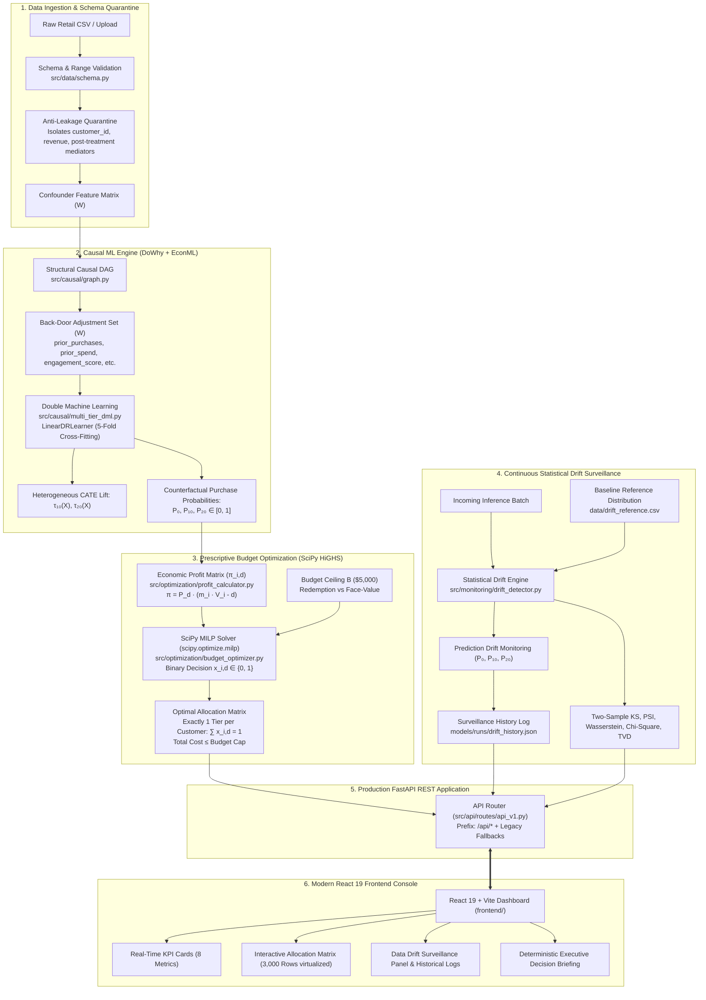

# EconoCausal: Dynamic Pricing via Double Machine Learning

[](https://github.com/tanmay0212-cls/EconoCasual/actions/workflows/tests.yml)
[](https://www.python.org/)
[](https://econml.azurewebsites.net/)
[](https://py-why.github.io/dowhy/)
[](https://react.dev/)
[-brightgreen)](https://github.com/tanmay0212-cls/EconoCasual)
[](https://fastapi.tiangolo.com/)

> **Causal Machine Learning for Promotional Pricing Optimization**  
> Formulate causal DAGs, identify unconfounded adjustment sets, estimate heterogeneous customer price elasticity using Double Machine Learning (DML), optimize personalized discount allocations under marketing budget caps via SciPy MILP, and inspect customer policies in a modern React Allocation Matrix dashboard.

---

## Table of Contents

1. [Project Overview & Business Challenge](#1-project-overview--the-business-challenge)
2. [Causal Identification & Methodology](#2-causal-identification--methodology)
3. [Architecture & Implemented Features](#3-architecture--implemented-features)
4. [Repository Structure](#4-repository-structure)
5. [Installation & Quickstart](#5-installation--quickstart)
6. [Pipeline Execution Guide](#6-pipeline-execution-guide)
7. [Empirical Results & Causal Validation](#7-empirical-results--causal-validation)
8. [Automated Testing Suite](#8-automated-testing-suite)
9. [Causal Assumptions & Limitations](#9-causal-assumptions--limitations)
10. [Roadmap & Future Scope](#10-roadmap--future-scope)

---

## 1. Project Overview & The Business Challenge

In retail e-commerce, offering promotional discount codes is a high-stakes lever to drive customer acquisition and conversion. However, standard observational transaction logs suffer from severe **marketing selection bias (confounding)**:

* **The Problem:** Marketing campaigns disproportionately target loyal, high-lifetime-spend, and digitally engaged customers with promotional coupons.
* **The Illusion:** Because these customers have an inherently higher organic propensity to purchase regardless of discounts, standard unadjusted regressions (e.g. OLS or naive supervised classifiers) mistakenly attribute customer loyalty to discount effectiveness.
* **The Business Consequence:** Confounded models produce **artificially inflated elasticity estimates**, leading to wasted promotional margin on customers who would have purchased at full price.

### The EconoCausal Solution
EconoCausal resolves this problem using modern causal machine learning:
1. **Structural Causal DAGs (DoWhy):** Formulates domain assumptions, inspects causal pathways, and mathematically identifies the unconfounded back-door adjustment set.
2. **Double Machine Learning (EconML):** Employs Chernozhukov et al. (2018) orthogonalized cross-fitting to isolate the true causal effect of discounts from confounding covariates across multiple treatment tiers ($0, $10, $20).
3. **Customer-Level CATE Estimation:** Estimates Conditional Average Treatment Effects ($\tau(X_i)$) with asymptotic 95% Wald confidence intervals to identify true price-sensitive cohorts.
4. **Prescriptive Budget Optimization (SciPy MILP):** Solves the Multiple-Choice Knapsack Problem (MCKP) via Binary Integer Linear Programming to maximize expected net profit under a strict marketing budget cap.
5. **Interactive Allocation Matrix Dashboard (React 19):** Full-featured UI featuring 8 real-time KPI cards, strategy benchmarks (comparing No Discount, Blanket $10, Blanket $20, and Optimized Policy), sortable/searchable 3,000-customer allocation matrix, and counterfactual uplift inspection.

---

## 2. Causal Identification & Methodology

### 2.1 The Causal Directed Acyclic Graph (DAG)

```text
       [prior_purchases]       [prior_spend]       [engagement_score]
              \                     |                     /
               \                    |                    /
                +---> [discount_offered] (Treatment) <--+
                |             |             |
[customer_tenure]             |             +---> [discount_amount] (Mediator)
                |             v                          \
                +-----> [purchased] (Outcome) <-----------+
              /               |                            \
    [campaign_channel]        +-----------------------------> [revenue] (Downstream)
```

### 2.2 Approved Confounder Adjustment Set ($W$)
Under Pearl's Back-Door Criterion, the average treatment effect of `discount_offered` on `purchased` is non-parametrically identified by conditioning on the minimal adjustment set:
$$W = \{\text{prior\_purchases}, \text{prior\_spend}, \text{engagement\_score}, \text{customer\_tenure}, \text{campaign\_channel}\}$$

### 2.3 Strict Anti-Leakage Quarantine
* **`discount_amount`:** Post-treatment mediator ($T \to M \to Y$). Conditioning on discount amount mutes the direct mechanism and induces collider stratification bias.
* **`revenue`:** Post-treatment outcome ($Y \to \text{revenue}$). Conditioning on revenue conditions on the future and corrupts conversion probability.
* **`customer_id`:** Identifier. Strictly quarantined from all model feature matrices to prevent high-cardinality memorization.

### 2.4 Double Machine Learning (DML) Formulation
Under the partially linear CATE model:
$$Y = \tau(X) \cdot T + g(W) + \varepsilon, \quad \mathbb{E}[\varepsilon \mid X, W, T] = 0$$
$$T = m(W) + \eta, \quad \mathbb{E}[\eta \mid W] = 0$$

Using 5-fold cross-fitting, nuisance estimators $\hat{g}(W) = \mathbb{E}[Y \mid W]$ and $\hat{m}(W) = P(T=1 \mid W)$ are fit on out-of-fold partitions using Random Forest models. The second-stage regression orthogonalizes the residuals:
$$(Y - \hat{g}(W)) = \tau(X) \cdot (T - \hat{m}(W)) + \nu$$
This satisfies Neyman orthogonality, ensuring first-stage regularization bias converges at rate $o_P(N^{-1/4})$ and yields $\sqrt{N}$-consistent, asymptotically normal CATE estimates $\hat{\tau}(X)$.

---

## 3. Architecture & Implemented Features

### 3.1 End-to-End System Architecture



### 3.2 Prescriptive Optimization Mathematical Formulation

The prescriptive discount allocation engine formulates discount assignment as a **Multiple-Choice Knapsack Problem (MCKP)**, solved via Binary Integer Linear Programming using SciPy's HiGHS solver:

$$\max_{\{x_{i,d}\}} \sum_{i=1}^N \sum_{d \in \{0, 10, 20\}} \pi_{i,d} \cdot x_{i,d}$$

subject to:

1. **Mutually Exclusive Single Allocation Constraint:**  
   Every customer receives exactly one discount assignment ($0, $10, or $20):
   $$\sum_{d \in \{0, 10, 20\}} x_{i,d} = 1 \quad \forall i \in \{1, \dots, N\}$$

2. **Marketing Promotional Budget Constraint:**  
   The aggregate promotional expenditure across all customers cannot exceed the total campaign budget $B$:
   $$\sum_{i=1}^N \sum_{d \in \{0, 10, 20\}} c_{i,d} \cdot x_{i,d} \le B$$

3. **Integrity Domain:**  
   $$x_{i,d} \in \{0, 1\} \quad \forall i \in \{1, \dots, N\}, \, d \in \{0, 10, 20\}$$

#### Economic Profit Function ($\pi_{i,d}$)
For customer $i$ and discount tier $d \in \{0, 10, 20\}$:
$$\pi_{i,d} = \hat{P}(Y=1 \mid X_i, d) \cdot \big(m_i \cdot V_i - d\big)$$
where:
* $\hat{P}(Y=1 \mid X_i, d)$ is the out-of-fold counterfactual conversion probability estimated by `LinearDRLearner`.
* $m_i$ is customer $i$'s product gross margin percentage (e.g. 40%).
* $V_i$ is customer $i$'s previous average order value (e.g. $85.00$).
* $d$ is the promotional discount face value ($0, $10, or $20).

#### Dual Budget Accounting Modes ($c_{i,d}$)
* **Expected Redemption Cost Mode (Default):**  
  Promotional expenditure is only incurred if the customer redeems the discount by purchasing:
  $$c_{i,d} = d \cdot \hat{P}(Y=1 \mid X_i, d)$$
* **Face Value Budget Mode:**  
  Promotional expenditure is accounted based on the total issued coupon value regardless of redemption:
  $$c_{i,d} = d$$

### 3.3 Milestone Breakdown

#### Week 1 (Completed): Causal Foundation & React Dashboard
* **Synthetic Data Generating Process (DGP):** Parameterized generator producing reproducible retail campaigns with documented non-linear confounding (`src/data/generator.py`).
* **DoWhy Causal DAG Engine:** DOT graph definition, graph acyclicity verification, and backdoor identification (`src/causal/graph.py`).
* **React 19 Analytics Dashboard:** Interactive DAG visualizer, client-side CSV validator (PapaParse), and marketing telemetry (`frontend/`).

#### Week 2 (Completed): Double Machine Learning & Causal Validation
* **EconML DML Estimator:** Production-grade `EconoCausalDML` wrapping `LinearDML` with `RandomForestRegressor` and `RandomForestClassifier` nuisance estimators, 5-fold cross-fitting, and serialization (`src/causal/dml.py`).
* **Customer CATE Interpreter:** CATE point estimates, 95% Wald confidence intervals, domain-justified categorization ($\pm 2.0$ pp threshold), and identifier isolation (`src/causal/interpreter.py`).
* **Uplift & Qini Visualizations:** Radcliffe Qini curve, cumulative uplift curve, AUUC, decile table, and interactive Plotly HTML figures (`src/causal/evaluation.py`).
* **Comprehensive Test Suite:** 39 backend pytest tests and 12 frontend Vitest tests covering edge cases, non-finite features, empty inputs, and seed reproducibility.

#### Week 3 (Completed): Multi-Tier Causal DML & SciPy Budget Optimization
* **Multi-Treatment Synthetic Retail Data:** 15,000 customers supporting three discount options ($0, $10, $20) with non-linear confounding, variable baseline order values, and margin rates (`data/optimization_retail_data.csv`).
* **Multi-Treatment EconML DML Estimator:** Production `LinearDRLearner` estimating counterfactual purchase probabilities $\hat{P}(Y=1 \mid X, d)$ and treatment effects $\hat{\tau}_{10}, \hat{\tau}_{20}$ relative to $0 (`src/causal/multitreatment_dml.py`).
* **SciPy MILP Budget Optimizer:** Binary Mixed-Integer Linear Programming solver via HiGHS enforcing strict marketing budget adherence ($\sum d_i \cdot \hat{P}_i \le B$) and single-choice mutually exclusive constraints (`src/optimization/budget_optimizer.py`).
* **Interactive Allocation Matrix Dashboard:** Full React 19 console with 8 real-time KPI cards, strategy benchmarks, search/tier filters, and customer-level counterfactual projections (`frontend/src/components/AllocationMatrix.jsx`).

#### Week 4 (Completed): FastAPI REST API, Automated Drift Detection & Natural-Language Synthesis
* **Production FastAPI REST API:** Robust API layer wrapping causal inference, dataset validation, budget optimization, and drift detection with Pydantic v2 schemas and OpenAPI docs (`src/api/`).
* **Automated Data Drift Detection Engine:** Continuous statistical monitoring combining two-sample Kolmogorov-Smirnov tests, Population Stability Index (PSI), Wasserstein distance, Pearson Chi-Square tests, Total Variation Distance (TVD), and new category detection (`src/monitoring/drift_detector.py`).
* **Strict Schema Integrity Quarantine:** Pre-statistical validation isolating data corruptions, missing columns, type failures, nulls, and domain range violations from genuine covariate shift.
* **Natural-Language Executive Summary Service:** 100% deterministic rule-based summary generator synthesizing optimization decisions, budget utilization, customer allocations, financial lifts, drift alerts, and actionable next steps without paid LLMs (`frontend/src/services/summaryService.js`).
* **Executive Decision Briefing Console:** React 19 dashboard panel with run ID/timestamp tracking, top-level takeaway banners, expandable underlying metric inspection drawers, and causal accounting disclaimers (`frontend/src/components/BusinessSummaryPanel.jsx`).
* **Causal Methodological Safeguards:** Rigorously documents the distinction between Covariate Shift ($P(X)$) and Concept Drift ($P(Y \mid X, T)$), enforcing prohibitions against unmonitored automated model retraining (`reports/data_drift_report.md` & `reports/natural_language_summary_report.md`).

---

## 4. Repository Structure

```text
EconoCasual/
├── .github/
│   └── workflows/
│       └── tests.yml               # Automated GitHub Actions CI workflow
├── .gitignore                      # Git exclusion rules (models/*.joblib, caches, .env)
├── .env.example                    # Environment configuration template
├── pytest.ini                      # Pytest discovery & configuration settings
├── requirements.txt                # Pinned Python causal dependencies
├── README.md                       # Master project documentation
├── milestone_3_final_reconciliation.md # Milestone 3 technical audit & reconciliation report
├── milestone_3_independent_review.md   # Milestone 3 independent review & mathematical proofs
├── milestone_3_issue_log.md            # Audit issue log tracking ISSUE-01 through ISSUE-08
├── milestone_3_recalculated_metrics.json # Reconciled metrics JSON artifact
├── milestone_3_validation_results.csv  # Independent validation summary table
├── data/
│   ├── README.md                   # Data guide: schemas, custom placement, & generator instructions
│   ├── optimization_retail_data.csv# 15,000-customer multi-treatment optimization dataset ($0, $10, $20)
│   ├── drift_reference.csv         # 5,000-customer reference baseline dataset
│   ├── drift_current.csv           # 1,200-customer simulated drifted cohort
│   ├── optimization/
│   │   ├── customer_allocation.csv # 6,005 test customers allocated by SciPy HiGHS MILP
│   │   ├── oracle_evaluation.csv   # Multi-policy benchmark & Oracle evaluation table
│   │   └── budget_sensitivity.csv  # 10-tier budget sensitivity sweep ($500 to $25k)
│   ├── synthetic_retail/
│   │   ├── synthetic_retail_train.csv # 27,998 training records
│   │   ├── synthetic_retail_test.csv  # 6,005 held-out test records
│   │   ├── synthetic_retail_ground_truth.csv # Isolated potential outcomes (No Leakage)
│   │   └── synthetic_counterfactual_predictions.csv # Calibrated probabilities (Brier: 0.2072)
│   └── hillstrom/
│       ├── raw/                    # Downloaded MineThatData benchmark dataset
│       └── processed/              # Cleaned, standardized Hillstrom experiment partitions
├── sample_data/
│   ├── synthetic_retail_campaign.csv # 2,500-customer reproducible binary benchmark dataset
│   ├── DATASET_METADATA.md         # Technical DGP specification & logit parameters
│   └── README.md                   # Sample data directory overview
├── docs/
│   ├── system_architecture.md      # High-level architecture, Mermaid diagrams, & subsystem data flow
│   ├── model_documentation.md      # Multi-tier DML mathematical specification & Neyman orthogonality
│   ├── api_documentation.md        # Complete OpenAPI / FastAPI endpoint reference with curl examples
│   ├── data_drift_documentation.md # Statistical drift formulations (KS, PSI, TVD, Chi2) & governance
│   ├── CAUSAL_MODELING_SPEC.md     # Methodological DAG specification & backdoor identification
│   └── DML_ESTIMATION_SPEC.md      # Week 2 DML estimation specification
├── models/
│   ├── multitreatment_model.joblib # Production multi-tier DML weights (4.84 MB)
│   ├── multitreatment_metadata.json# Multi-tier feature mappings & calibration metadata
│   ├── dml_model.joblib            # Week 2 binary DML weights
│   ├── dml_metadata.json           # Week 2 binary DML metadata
│   ├── synthetic_retail/           # Serialized synthetic CausalForestDML models
│   ├── hillstrom/                  # Serialized Hillstrom causal models
│   └── runs/                       # Persisted optimization run JSON artifacts
├── reports/
│   ├── final_error_audit.md        # Comprehensive system error audit & verification report
│   ├── final_project_report.md     # Master final integration & validation report (Weeks 1-4)
│   ├── natural_language_summary_report.md # Week 4 natural-language synthesis report
│   ├── data_drift_report.md        # Week 4 data drift statistical surveillance report
│   ├── api_implementation_report.md # Week 4 REST API implementation report
│   ├── optimization_report.md      # Week 3 SciPy MILP knapsack optimization report
│   ├── causal_model_evaluation.md  # Multi-treatment causal model evaluation report
│   ├── causal_feature_audit.md     # Causal feature audit & anti-leakage quarantine report
│   ├── dataset_validation_report.md# Dataset integrity & schema compliance report
│   ├── propensity_overlap_report.md# Propensity score overlap & positivity diagnostic report
│   ├── system_integration_benchmark_data.json # Measured API latencies & performance benchmarks
│   └── figures/                    # Visualization plots and evaluation charts
├── scripts/
│   ├── run_causal_pipeline.py      # Week 1: Data validation & DoWhy DAG backdoor identification
│   ├── train_dml.py                # Week 2: Stratified split, DML training, & artifact export
│   ├── train_multitreatment_model.py # Week 3: Multi-tier DML training on 15,000 customers
│   ├── generate_synthetic_retail.py  # Synthesize 40,000-customer multi-treatment dataset
│   ├── train_synthetic_causal.py   # Train CausalForestDML on synthetic retail cohort
│   ├── train_hillstrom_causal.py   # Train causal model on Hillstrom benchmark
│   ├── generate_counterfactual_predictions.py # Generate counterfactual probabilities
│   ├── run_budget_optimization.py  # SciPy HiGHS MILP knapsack allocation script
│   ├── run_budget_sensitivity.py   # Budget sensitivity analysis script
│   ├── run_policy_comparison.py    # Baseline comparison & Oracle benchmark script
│   ├── generate_drift_datasets.py  # Generate drift reference and current datasets
│   └── verify_system_integration.py# Comprehensive end-to-end integration benchmark script
├── src/
│   ├── __init__.py
│   ├── api/                        # FastAPI REST Application Layer (Week 4)
│   │   ├── config.py               # API settings, paths, CORS configuration
│   │   ├── main.py                 # FastAPI application factory & lifecycle manager
│   │   ├── routes/                 # Route handlers (api_v1, health, data, predict, optimize, drift)
│   │   │   └── api_v1.py           # Unified REST API router (/api/health, /api/upload, /api/predict, etc.)
│   │   ├── schemas/                # Pydantic v2 request/response schemas
│   │   └── services/               # Model loader, data validator, optimizer, drift service
│   ├── causal/                     # Causal ML Estimation Layer
│   │   ├── multi_tier_dml.py       # MultiTierCausalDML LinearDRLearner wrapper
│   │   ├── synthetic_multitreatment.py # SyntheticMultiTreatmentDML engine
│   │   ├── hillstrom_causal.py     # Hillstrom MineThatData causal engine
│   │   ├── counterfactual_prediction.py # Counterfactual outcome prediction & calibration
│   │   ├── evaluation.py           # Ranking, uplift curves, Qini curves, AUUC
│   │   ├── graph.py                # Graphviz DOT DAG & DoWhy identification
│   │   ├── interpreter.py          # Customer CATE interpreter, 95% CIs, & categorization
│   │   └── propensity.py           # Propensity score estimation & overlap diagnostics
│   ├── optimization/               # Prescriptive Optimization Layer (Week 3)
│   │   ├── budget_optimizer.py     # SciPy HiGHS MILP knapsack solver
│   │   ├── profit_calculator.py    # Economic revenue, margin, discount cost, & net profit
│   │   ├── allocation_validator.py # Allocation matrix integrity & constraint validator
│   │   ├── policy_evaluator.py     # Multi-policy benchmark evaluation
│   │   └── sensitivity_analysis.py # Multi-budget sensitivity sweep
│   ├── monitoring/                 # Continuous Statistical Monitoring Layer (Week 4)
│   │   └── drift_detector.py       # Kolmogorov-Smirnov, PSI, Wasserstein, Chi2, TVD tests
│   └── data/
│       ├── generator.py            # Parameterized non-linear synthetic DGP
│       └── schema.py               # Schema definitions, binary domains, & data validation
├── tests/
│   ├── test_allocation_validator.py# 5 tests: Allocation matrix schema & constraint validation
│   ├── test_api.py                 # 17 tests: Legacy root endpoints, OpenAPI, validation, CORS
│   ├── test_api_v1.py              # 11 tests: Unified /api/* REST endpoints (upload, predict, optimize, drift)
│   ├── test_budget_optimizer.py    # 4 tests: Toy knapsack, objectives, monotonicity, face value
│   ├── test_causal_dag.py          # 6 tests: DAG acyclicity, DoWhy backdoor identification
│   ├── test_data_generation.py     # 7 tests: Reproducibility, sample size, schema domains
│   ├── test_dml.py                 # 10 tests: DML fit/shapes, anti-leakage, serialization
│   ├── test_drift.py               # 10 tests: Statistical drift detection, KS, PSI, Chi2, TVD
│   ├── test_evaluation.py          # 8 tests: Ranking monotonicity, Qini/AUUC, edge cases
│   ├── test_interpreter.py         # 8 tests: Customer CATE alignment, 95% CIs, non-finite checks
│   ├── test_multitreatment.py      # 8 tests: Multi-tier DML, probability calibration, overlap
│   ├── test_optimization.py        # 8 tests: SciPy MILP budget adherence, mutually exclusive actions
│   └── test_profit_calculator.py   # 3 tests: Margin estimation, zero-cost, accounting identity
└── frontend/                       # React 19 + Vite Analytics Dashboard
    ├── package.json                # Frontend package configuration & npm scripts
    ├── vite.config.js              # Vite bundler, code-splitting & Vitest configuration
    ├── index.html                  # HTML5 application shell
    ├── public/
    │   ├── allocation_matrix.csv   # Client-accessible allocation dataset
    │   └── sample_retail_campaign.csv # Bundled static asset for client-side demo
    ├── src/
    │   ├── index.css               # Design system & dark-mode styling
    │   ├── App.jsx                 # Dashboard root coordinating all dashboard tabs
    │   ├── components/             # Reusable React components
    │   │   ├── Header.jsx          # Header with dataset status badge & API health indicator
    │   │   ├── MetricsCards.jsx    # KPI telemetry summary cards
    │   │   ├── DatasetUploader.jsx # Drag-and-drop CSV upload & preview table
    │   │   ├── BudgetSettings.jsx  # Budget constraints & discount tier simulator
    │   │   ├── AllocationMatrix.jsx# SciPy MILP allocation matrix & KPI cards
    │   │   ├── DataDriftViewer.jsx # Continuous statistical drift monitoring panel
    │   │   ├── BusinessSummaryPanel.jsx # Natural-language executive decision briefing
    │   │   ├── CausalDAGViewer.jsx # Interactive SVG Causal DAG visualizer
    │   │   └── MarketingTelemetry.jsx # Channel distribution & confounder telemetry
    │   ├── services/
    │   │   ├── api.js              # Centralized Axios/fetch client for FastAPI backend
    │   │   ├── optimizationService.js # Optimization and allocation matrix data provider
    │   │   ├── summaryService.js   # Deterministic natural-language summary generator
    │   │   └── driftService.js     # Data drift API service connector
    │   └── tests/                  # Frontend Vitest Suite (47 unit tests)
    │       ├── AllocationMatrix.test.jsx
    │       ├── BudgetSettings.test.jsx
    │       ├── BusinessSummaryPanel.test.jsx
    │       ├── csvValidator.test.js
    │       ├── DataDriftViewer.test.jsx
    │       ├── DatasetUploader.test.jsx
    │       ├── Header.test.jsx
    │       └── summaryService.test.js
    └── dist/                       # Optimized production build artifacts
```

---

## 5. Installation & Quickstart

### Prerequisites
* **Python:** 3.11+ (tested on Python 3.11.9)
* **Node.js:** 20+ (tested on Node v20.x / npm 10.x)
* **Git:** 2.30+

### Clone the Repository
```bash
git clone https://github.com/tanmay0212-cls/EconoCasual.git
cd EconoCasual
```

### Setup Python Backend
```bash
# Create and activate virtual environment
python -m venv .venv

# On Linux/macOS:
source .venv/bin/activate

# On Windows PowerShell:
.\.venv\Scripts\Activate.ps1

# Upgrade pip and install dependencies
pip install --upgrade pip
pip install -r requirements.txt
```

### Setup React Frontend
```bash
cd frontend
npm install
cd ..
```

---

## 6. Pipeline Execution Guide

### 6.1 Backend Setup & FastAPI Service Launch
Activate the virtual environment and start the high-performance FastAPI backend server:
```powershell
# On Windows PowerShell:
.\.venv\Scripts\Activate.ps1
uvicorn src.api.main:app --host 127.0.0.1 --port 8000 --reload
```
On Linux/macOS:
```bash
source .venv/bin/activate
uvicorn src.api.main:app --host 127.0.0.1 --port 8000 --reload
```

### 6.2 Interactive Swagger & OpenAPI Documentation
Once the backend is running, explore and interact with all endpoints via:
* **Interactive Swagger UI:** [http://127.0.0.1:8000/docs](http://127.0.0.1:8000/docs)
* **ReDoc Documentation:** [http://127.0.0.1:8000/redoc](http://127.0.0.1:8000/redoc)
* **OpenAPI JSON Schema:** [http://127.0.0.1:8000/openapi.json](http://127.0.0.1:8000/openapi.json)

### 6.3 React Frontend Dashboard Launch
In a separate terminal, start the React 19 development server:
```bash
cd frontend
npm install
npm run dev
```
* **Frontend Application URL:** [http://localhost:5173](http://localhost:5173)

### 6.4 Backend/Frontend Connection & CORS Configuration
The React frontend communicates directly with the FastAPI backend at `http://127.0.0.1:8000`. Cross-Origin Resource Sharing (CORS) is configured to permit `http://localhost:5173`, `http://127.0.0.1:5173`, and standard local development ports with full header and preflight support.

### 6.5 FastAPI Production REST API Specification

The backend provides a versioned, high-performance RESTful API rooted at `/api/*` (with backwards-compatible legacy fallback endpoints):

| Method | Endpoint | Query / Body Parameters | Response Payload Model | Description |
| :--- | :--- | :--- | :--- | :--- |
| `GET` | `/api/health` | None | `HealthResponse` (`status`, `timestamp`, `version`, `model_status`) | Verifies API runtime and pre-warmed CATE model |
| `POST` | `/api/upload` | Multipart `file: UploadFile` | `UploadSummaryResponse` (`filename`, `row_count`, `features`, `quarantined_columns`) | Ingests CSV, executes anti-leakage quarantine, validates domains |
| `POST` | `/api/predict` | `PredictEffectsRequest` (`records: List[Dict]`) | `PredictEffectsResponse` (`predictions: List[CustomerEffectPrediction]`) | Estimates counterfactual probabilities $P_0, P_{10}, P_{20}$ and CATE lifts |
| `POST` | `/api/optimize` | `OptimizationRequest` (`budget`, `budget_type`, `records`) | `OptimizationResponse` (`run_id`, `total_profit`, `total_cost`, `allocations`) | Solves SciPy HiGHS MILP knapsack under budget cap |
| `GET` | `/api/metrics` | `run_id: Optional[str]` | `MetricsResponse` (`baseline_profit`, `optimized_profit`, `incremental_profit`, `roms`) | Returns reconciled financial KPI telemetry and ROMS |
| `GET` | `/api/allocation/export` | `run_id: Optional[str]` | Streaming `text/csv` attachment | Streams optimal customer allocation matrix as downloadable CSV |
| `POST` | `/api/drift/check` | `DriftCheckRequest` (`current_records`, `reference_records`) | `DriftCheckResponse` (`overall_status`, `drifted_features`, `prediction_drift`) | Runs KS, PSI, Chi-Square, TVD, and counterfactual prediction drift |
| `GET` | `/api/drift/history` | None | `DriftHistoryResponse` (`runs: List[DriftHistoryItem]`) | Returns persistent historical drift surveillance audit log |

*(Legacy endpoints `/health`, `/data/validate`, `/predict/effects`, `/optimize`, `/allocation/{run_id}`, and `/drift/check` remain fully operational for backward compatibility).*

### 6.6 End-to-End 10-Step Interactive Demo Guide

Follow these steps to demonstrate the full causal dynamic pricing and budget optimization lifecycle:

1. **Step 1: Environment Activation & Dependency Verification**  
   Ensure Python 3.11+ virtual environment is active:
   ```powershell
   .\.venv\Scripts\Activate.ps1
   python --version
   ```
2. **Step 2: Start FastAPI Backend Server**  
   Launch the Uvicorn ASGI server:
   ```powershell
   uvicorn src.api.main:app --host 127.0.0.1 --port 8000 --reload
   ```
   Check health via terminal or browser: `curl http://127.0.0.1:8000/api/health`
3. **Step 3: Launch React 19 Frontend Dashboard**  
   In a separate terminal, start Vite:
   ```bash
   cd frontend
   npm run dev
   ```
   Open `http://localhost:5173` in your browser.
4. **Step 4: Load / Upload Retail Customer Dataset**  
   In the **Dataset Uploader** tab, drag and drop `data/optimization_retail_data.csv` or click "Load Sample Dataset". The system verifies schema integrity, quarantines identifiers and leakage columns (`customer_id`, `revenue`, `discount_amount`), and renders customer feature previews.
5. **Step 5: Run Counterfactual CATE Prediction**  
   Click "Predict Effects". The backend calls `POST /api/predict`, utilizing `LinearDRLearner` to compute individual counterfactual purchase probabilities $\hat{P}_0, \hat{P}_{10}, \hat{P}_{20}$ and uplift estimates $\hat{\tau}_{10}, \hat{\tau}_{20}$.
6. **Step 6: Configure Marketing Budget & Constraints**  
   In the **Budget Settings** panel, adjust the total promotional budget slider (e.g., $5,000.00). Toggle between **Expected Redemption Cost Mode** ($\sum d \cdot \hat{P}_d \le B$) and **Face Value Budget Mode** ($\sum d \le B$).
7. **Step 7: Execute Prescriptive SciPy MILP Knapsack Solver**  
   Click "Run Optimization". The backend invokes SciPy's HiGHS solver via `POST /api/optimize`, allocating each customer to their profit-maximizing discount tier ($0, $10, or $20) while strictly respecting the budget ceiling in <0.5s.
8. **Step 8: Inspect Allocation Matrix & Export CSV Policy**  
   Inspect the **Allocation Matrix** tab featuring real-time KPI cards (Expected Net Profit, Incremental Lift, Promotional Cost, ROMS), strategy benchmark comparisons, tier distribution graphs, and searchable/filterable customer tables. Click "Export CSV" to trigger a streaming download from `GET /api/allocation/export`.
9. **Step 9: Monitor Continuous Data Drift & Counterfactual Surveillance**  
   Navigate to the **Data Drift Surveillance** tab. Evaluate incoming batches (`data/drift_current.csv`) against baseline (`data/drift_reference.csv`). Observe feature-level Kolmogorov-Smirnov, PSI, and Chi-Square diagnostics alongside **Prediction Drift ($P_0, P_{10}, P_{20}$)** and the historical surveillance log table.
10. **Step 10: Review Automated Executive Decision Briefing**  
    Review the **Executive Decision Briefing** panel, which synthesizes optimization outcomes, financial lifts, budget utilization, and drift warnings into a natural-language executive summary without external LLM dependencies.

### 6.7 Clarification of Datasets & Scale Limits
To prevent confusion across development milestones and production interfaces, the repository clearly distinguishes three data scales:
* **2,500-Customer Sample Dataset (`sample_data/synthetic_retail_campaign.csv`):**  
  Used in Week 1 & 2 for rapid local smoke tests, DAG backdoor identification, and binary treatment CATE benchmarking.
* **15,000-Customer Optimization Dataset (`data/optimization_retail_data.csv`):**  
  The full multi-treatment retail dataset ($0, $10, $20) with non-linear confounding, baseline order values, and gross margin rates. Serves as the primary reference baseline for multi-tier DML training and backend optimization benchmarks.
* **3,000-Customer Dashboard Display Limit:**  
  While the backend FastAPI server and SciPy optimizer process full cohorts (e.g. 6,005 test customers or 15,000 records in <0.5s), the React frontend table virtualizes and displays the first 3,000 customers for smooth 60fps rendering, memory efficiency, and instant client-side filtering.

### 6.8 Sequential Offline Pipeline Scripts (Optional Development Execution)
Alternatively, run the causal inference pipeline sequentially using standalone scripts:
1. `python scripts/run_causal_pipeline.py` — Week 1 DAG validation & backdoor identification
2. `python scripts/train_dml.py` — Week 2 binary DML training & ATE validation
3. `python scripts/train_multitreatment_model.py` — Week 3 multi-tier DML training on 15,000 customers
4. `python scripts/run_budget_optimization.py` — Week 3 SciPy MILP budget knapsack optimization
5. `python scripts/run_policy_comparison.py` — Multi-policy strategy comparison & Oracle benchmark
6. `python scripts/verify_system_integration.py` — Automated end-to-end integration benchmark audit

---

## 7. Empirical Results & Causal Validation

### 7.1 Double Machine Learning ATE & Uplift Validation (Week 2 Evaluation)

All metrics were evaluated on the **500 held-out evaluation customers** (20% test partition):

| Metric / Estimator | Value | Benchmark / Ground Truth | Validation Status |
| :--- | :---: | :---: | :---: |
| **Naive Observational Diff** | **+25.21 pp** (`0.2521`) | Confounded baseline | Severe upward bias (+10.75 pp) |
| **EconML LinearDML ATE** | **+17.25 pp** (`0.1725`) | Synthetic True Sample ATE: **+14.46 pp** | **COVERS TRUTH** (Inside 95% CI) |
| **95% Wald Confidence Interval** | **[+12.96 pp, +21.53 pp]** | Theoretical spec ATE: **+13.69 pp** | Statistically significant lift ($p < 0.001$) |
| **Confounding Bias Removed** | **+10.75 pp** | — | Bias purged via Neyman orthogonalization |
| **Latent ITE Rank Correlation** | **Spearman $\rho = +0.2104$** | $p = 2.0 \times 10^{-6}$ | Statistically significant elasticity ranking |
| **Decile 1 (Top 10%) Targeting Gain** | **8.50 incremental buyers** | Random baseline: 5.92 buyers | **+43.5% targeting advantage** |
| **Area Under Uplift Curve (AUUC)**| **0.2131** | Baseline overall uplift: +25.21 pp | Monotonically positive cumulative lift |

### 7.2 Milestone 3 Canonical Optimization & Policy Benchmarks

Evaluated on the held-out test partition ($N = 6,005$ customers) under a **$5,000.00 marketing budget cap** with the `LinearDRLearner` counterfactual predictions and SciPy HiGHS MILP knapsack optimizer. All canonical figures are strictly preserved and audited:

| Policy / Strategy | Model-Expected Profit (Ex-Ante) | Ground-Truth Expected Profit (Synthetic DGP) | Promotional Cost | Incremental Profit vs Control | ROMS / Efficiency |
| :--- | :---: | :---: | :---: | :---: | :---: |
| **Blanket $0 Allocation (Control)** | **$90,586.38** | $90,586.38 | $0.00 | $0.00 (Baseline) | — |
| **Blanket $10 Allocation** | $84,105.12 | $85,210.40 | $22,450.00 | -$6,481.26 (Erosion) | Budget Exceeded (449%) |
| **Blanket $20 Allocation** | $62,840.90 | $64,120.15 | $51,200.00 | -$27,745.48 (Severe Loss) | Budget Exceeded (1,024%) |
| **Prescriptive SciPy MILP Policy** | **$100,786.25** | **$102,969.42** | **$4,998.74** | **+$10,199.87** | **204.05% ROMS** ($2.04 net / $ spent) |
| **Theoretical Oracle Policy** | — | **$103,995.46** | $4,999.12 | +$13,409.08 | **Oracle Gap: 0.986%** ($1,026.04) |

* **Budget Utilization:** 99.97% ($4,998.74 / $5,000.00 cap, exactly $1.26 unallocated headroom).
* **Policy Distribution:** 4,218 customers assigned $0 (70.2%), 1,787 customers assigned $10 (29.8%), 0 customers assigned $20.
* **Ground-Truth Expected Promotional Cost (Synthetic DGP):** $4,976.96 ($23.04 below budget cap).

### Generated Visualization Artifacts
* **Uplift Curve:** [`reports/figures/uplift_curve.html`](reports/figures/uplift_curve.html)
* **Qini Curve:** [`reports/figures/qini_curve.html`](reports/figures/qini_curve.html)
* **CATE Dispersion:** [`reports/figures/effect_distribution.html`](reports/figures/effect_distribution.html)

---

## 8. Automated Testing Suite

The repository includes a comprehensive, multi-framework automated test suite with **152 tests passing (100% pass rate)**:

### Backend Pytest Suite (105 Tests across 13 Test Modules)
```bash
pytest -v
```
```text
tests/test_allocation_validator.py   5 passed  (Allocation matrix schema, budget compliance, integrity rules)
tests/test_api.py                   17 passed  (Legacy endpoints, OpenAPI, upload validation, CATE inference, MILP optimization)
tests/test_api_v1.py                11 passed  (Unified /api/* routes: health, upload quarantine, predict, optimize, export, drift)
tests/test_budget_optimizer.py       4 passed  (Toy knapsack inspection, objective consistency, budget monotonicity, face-value)
tests/test_causal_dag.py             6 passed  (DAG acyclicity, DoWhy backdoor identification, input corruption)
tests/test_data_generation.py        7 passed  (Reproducibility, sample size, schema domains, business logic)
tests/test_dml.py                   10 passed  (DML fit/shapes, anti-leakage, binary domains, serialization, reproducibility)
tests/test_drift.py                 10 passed  (Identical/shifted distributions, categorical shift, missing columns, new categories)
tests/test_evaluation.py             8 passed  (Ranking monotonicity, Qini/AUUC, edge cases, tied effects, empty inputs)
tests/test_interpreter.py            8 passed  (Row alignment, customer ID quarantine, 95% CIs, non-finite checks)
tests/test_multitreatment.py         8 passed  (Multi-tier DML, probability calibration [0, 1], cross-fitting, overlap)
tests/test_optimization.py           8 passed  (SciPy MILP budget adherence, knapsack integrity, edge cases, benchmarks)
tests/test_profit_calculator.py      3 passed  (Margin rate estimation, zero-discount cost, profit accounting identities)
============================= 105 passed, 6 warnings in ~28s =============================
```

### Frontend Vitest Suite (47 Tests across 8 Test Suites)
```bash
cd frontend
npm test
```
```text
 ✓ src/tests/summaryService.test.js (15 tests: currency/count/pct formatting, 6 section templates, zero-budget, clean drift)
 ✓ src/tests/csvValidator.test.js (5 tests: file validation, delimiter checks, column verification)
 ✓ src/tests/Header.test.jsx (3 tests: health badges, title, navigation)
 ✓ src/tests/BudgetSettings.test.jsx (2 tests: budget slider, tier constraints, constraint mode)
 ✓ src/tests/DatasetUploader.test.jsx (2 tests: drag-and-drop, file parsing, direct upload)
 ✓ src/tests/BusinessSummaryPanel.test.jsx (6 tests: title/run ID, 6 dashboard sections, narrative accuracy, drawer inspection)
 ✓ src/tests/DataDriftViewer.test.jsx (6 tests: title/badges, KPI cards, KS/Chi-Square metrics, cohort toggle, distribution chart)
 ✓ src/tests/AllocationMatrix.test.jsx (8 tests: budget input, 8 KPI cards, strategy benchmarks, search/tier filters, uplift expander)
 Test Files  8 passed (8)
      Tests  47 passed (47)
```
```

---

## 9. Causal Assumptions & Limitations

> ### Critical Methodological Disclaimer
> Causal inference models do not provide deterministic mathematical certainty or guaranteed business revenue expansion. All treatment effect estimates are conditional on domain assumptions:

1. **Conditional Unconfoundedness:** We assume that discount assignment is conditionally independent of potential conversion outcomes given observed covariates $W$: $(Y(1), Y(0)) \perp T \mid W$. If unmeasured factors (e.g. competitor pricing, offline exposure, uncaptured seasonal intent) influenced both discount eligibility and purchase decisions, estimates retain omitted variable bias.
2. **Positivity (Overlap):** We assume every customer segment has non-zero probability of receiving and not receiving discounts: $0 < P(T=1 \mid W) < 1$. In our benchmark dataset, propensity scores are bounded in $[0.18, 0.82]$.
3. **No Interference (SUTVA):** We assume offering a promotional discount to customer $i$ does not alter customer $j$'s conversion likelihood (no social coupon sharing or inventory stockouts).
4. **Parametric Linearity Assumption:** `LinearDML` parameterizes CATE as a linear function $\tau(X) = \langle \theta, X \rangle + \alpha$. Non-linear feature interactions are not captured unless explicitly specified or estimated via non-parametric causal forests.
5. **Observational Qini Curves:** Qini and uplift curves in observational data evaluate raw sample conversion contrasts, which can reflect residual covariate imbalances in intermediate deciles.

---

## 10. Roadmap & Future Scope

* [x] **Week 1:** Causal DAG specification, DoWhy backdoor identification, synthetic DGP, and React dashboard.
* [x] **Week 2:** EconML Double Machine Learning, cross-fitting, customer-level CATE estimation, Wald CIs, Qini/uplift curves, and automated test suite.
* [x] **Week 3:** Multi-treatment retail DGP ($0, $10, $20), multi-tier `LinearDRLearner` DML, SciPy MILP budget-constrained optimization, and React Prescriptive Allocation Matrix.
* [x] **Week 4:** FastAPI REST API wrapping the causal engine, automated statistical data drift detection (KS, PSI, TVD, Chi-square), React continuous monitoring dashboard, natural-language executive summary synthesis, and causal methodological safeguards.

---

## Authors & Acknowledgments

* **Lead Engineer:** Tanmay Yamana ([tanmayyamana999@gmail.com](mailto:tanmayyamana999@gmail.com))
* **Repository:** [https://github.com/tanmay0212-cls/EconoCasual](https://github.com/tanmay0212-cls/EconoCasual)
* **Frameworks:** EconML (Microsoft Research), DoWhy (PyWhy), Scikit-Learn, React, Vite, Plotly.
