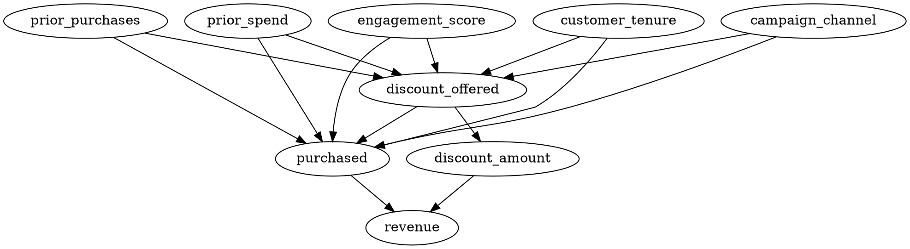

# Causal Modeling Specification: EconoCausal (Week 1)
**Project:** EconoCausal — Dynamic Pricing via Double Machine Learning  
**Company:** Infotact Solutions  
**Focus:** Structural Causal Directed Acyclic Graph (DAG) & Identification

---

## 1. Executive Summary & Week 1 Scope
In Week 1 of the EconoCausal project, we establish the structural causal foundation for assessing promotional discount effectiveness in retail e-commerce.

### Critical Causal Methodological Guardrails:
1. **The Graph Does Not "Prove" Causality:** A Directed Acyclic Graph (DAG) formalizes our structural hypotheses and domain knowledge into an explicit, falsifiable framework. It does not mechanically prove causality; it explicitly states the assumptions under which causal claims are identified.
2. **Identification vs. Estimation:** In Week 1, we formalize the DAG and execute Step 2 of the DoWhy framework (**Effect Identification** via the Back-door criterion). We do **not** claim a final numerical treatment effect has been established. Final estimation using **Double Machine Learning (DML)** with cross-fitting and machine learning nuisances is scheduled for Week 2.
3. **No Post-Treatment Confounders:** Variables measured or realized after the discount offer (`discount_amount`, `revenue`) are strictly excluded from the adjustment set to prevent conditioning on colliders or post-treatment mediators.

---

## 2. Causal DAG Architecture

```text
       [prior_purchases]       [prior_spend]       [engagement_score]
              \                     |                     /
               \                    |                    /
                +---> [discount_offered] (Treatment) <--+
                |             |             |
[customer_tenure]             |             +---> [discount_amount]
                |             v                          \
                +-----> [purchased] (Outcome) <-----------+
              /               |                            \
    [campaign_channel]        +-----------------------------> [revenue]
```

### Formal DOT Graph:


---

## 3. Confounder Justification (Why Each Variable is Included)

A variable $W$ is an observed confounder (common cause) if it influences both the treatment assignment $T$ and the outcome $Y$, opening a non-causal "back-door" path: $T \leftarrow W \rightarrow Y$.

| Confounder | Influence on Treatment Assignment ($W \rightarrow T$) | Influence on Outcome Conversion ($W \rightarrow Y$) | Consequence of Omitting |
| :--- | :--- | :--- | :--- |
| **`prior_purchases`** | Marketing loyalty algorithms reward repeat buyers with promotional codes. | Customers with high past order frequency naturally have high baseline conversion propensity. | **Upward bias:** discounts appear more effective than they are because they were disproportionately given to frequent buyers. |
| **`prior_spend`** | High cumulative lifetime spend qualifies customers for VIP discount tiers. | High-spending customers have higher disposable income and brand affinity. | **Omitted variable bias:** confounds price sensitivity with consumer purchasing power. |
| **`engagement_score`** | App/email click rates determine which users see targeted push notifications and in-app coupons. | Highly active users browse products frequently and convert at higher rates even without discounts. | **Selection bias:** discounts are correlated with organic shopping intent. |
| **`customer_tenure`** | Retention and anniversary campaigns target specific tenure cohorts (e.g., 6-month, 1-year loyalty perks). | Longer-tenured customers exhibit brand stickiness and established purchasing routines. | **Cohort confounding:** age of customer account biases elasticity estimates. |
| **`campaign_channel`** | Push and email channels have higher discount distribution rates than organic social. | Push and email traffic has distinct conversion baselines compared to top-of-funnel social traffic. | **Channel-mix bias:** channel responsiveness is mistakenly attributed to discount depth. |

---

## 4. Post-Treatment Variables & Avoidance of Collider Bias

### 1. `discount_amount`
* **Nature:** The dollar face value of the discount.
* **Why excluded from $W$:** Occurs *strictly after* the decision to offer a discount (`discount_offered = 1`). Conditioning on `discount_amount` when measuring the binary effect of offering a discount would condition on a mediator, muting the full causal impact of the treatment.

### 2. `revenue`
* **Nature:** The realized basket value post-purchase.
* **Why excluded from $W$:** Revenue is a terminal downstream outcome ($T \rightarrow Y \rightarrow \text{Revenue}$). Conditioning on revenue when studying conversion rate ($Y$) introduces collider stratification bias and conditioning on the future.

---

## 5. Identification via the Back-Door Criterion

Under Pearl's Causal Hierarchy and DoWhy's identification engine:
1. **Back-Door Path Blocking:** To identify the average causal effect $P(Y \mid do(T))$, we must condition on an adjustment set $Z \subseteq W$ such that:
   - No node in $Z$ is a descendant of $T$.
   - $Z$ blocks every path between $T$ and $Y$ that contains an arrow into $T$.
2. **Identified Minimal Adjustment Set:**
   $$Z = \{\text{prior\_purchases}, \text{prior\_spend}, \text{engagement\_score}, \text{customer\_tenure}, \text{campaign\_channel}\}$$
3. **Identified Estimand:**
   $$\mathbb{E}[Y \mid do(T=1)] - \mathbb{E}[Y \mid do(T=0)] = \sum_w \left( \mathbb{E}[Y \mid T=1, W=w] - \mathbb{E}[Y \mid T=0, W=w] \right) P(W=w)$$

---

## 6. Roadmap to Week 2: Double Machine Learning (DML)
With the DAG and identification verified, Week 2 will implement Double Machine Learning (Chernozhukov et al., 2018):
1. **Nuisance Model 1:** Residualizing Treatment: $\tilde{T} = T - \hat{m}(W)$ using Gradient Boosted Trees / LightGBM.
2. **Nuisance Model 2:** Residualizing Outcome: $\tilde{Y} = Y - \hat{g}(W)$ using Gradient Boosted Trees / LightGBM.
3. **Cross-Fitting:** 5-fold cross-fitting to avoid overfitting bias.
4. **Final Causal Orthogonal Estimation:** Regressing $\tilde{Y}$ on $\tilde{T}$ to recover the unconfounded Conditional Average Treatment Effect (CATE) across customer segments.
