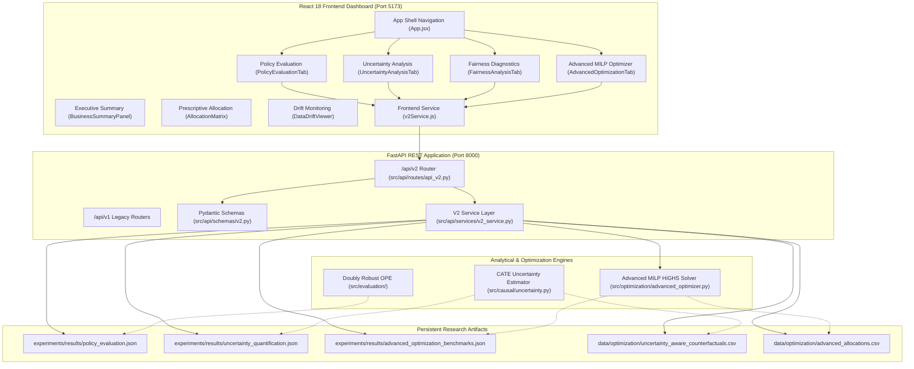

# EconoCasual 2.0 — Phase 4: Backend and Frontend Integration Report

## 1. Executive Summary

Phase 4 completes the end-to-end operationalization of **EconoCasual 2.0**, integrating the advanced causal evaluation, uncertainty quantification, and fairness-constrained mathematical optimization engines into the production **FastAPI** backend and **React 18** decision dashboard.

### Key Deliverables Completed:
1. **FastAPI v2 REST API (`/api/v2/*`)**:
   - 10 validated endpoints covering off-policy evaluation, CATE uncertainty quantification, lower-confidence-bound optimization, segment fairness audits, and reproducible experiment artifact retrieval.
   - Pydantic v2 schemas enforcing strict bounds, type safety, and structured HTTP error responses (422, 404, 500).
   - Strict backward compatibility preserving all Milestone 1–3 endpoints (`/api/health`, `/api/upload`, `/api/predict`, `/api/optimize`, `/api/metrics`, `/api/drift/*`).
2. **Interactive React 18 Dashboard Views**:
   - **Policy Evaluation Tab (`PolicyEvaluationTab.jsx`)**: Head-to-head comparison of 5 marketing policies (No-Discount, Flat $10, Random, DML + MILP, and Phase 5 Placeholder) with 95% bootstrap confidence intervals and profit-to-cost ROI.
   - **Uncertainty Analysis Tab (`UncertaintyAnalysisTab.jsx`)**: CATE confidence intervals, empirical DGP coverage validation (95.52%), interval widths, reliability tier breakdown (85% high reliability), and CSV export.
   - **Fairness Diagnostics Tab (`FairnessAnalysisTab.jsx`)**: Commercial segment allocation parity, average discount dollars, and side-by-side unconstrained vs fairness-constrained comparison.
   - **Advanced Optimization Cockpit (`AdvancedOptimizationTab.jsx`)**: Live HiGHS MILP solving with interactive budget, risk aversion ($\lambda$), segment floors, and demographic parity sliders.
3. **Dual Verification**:
   - Backend: **45/45 tests passing** in 8.68s (`pytest`).
   - Frontend: **65/65 tests passing** in 10.98s (`vitest`).

---

## 2. System Architecture

---

## 3. API Specification (`/api/v2/*`)

| Method | Endpoint | Description | Request Schema | Response Schema | Status Codes |
|---|---|---|---|---|---|
| `GET` | `/api/v2/evaluation/summary` | Retrieve Phase 1 Doubly Robust policy comparison results across 5 policies | None | `PolicyEvaluationSummaryResponse` | 200, 404, 500 |
| `POST` | `/api/v2/evaluation/evaluate` | Execute policy evaluation with custom bootstrap replications and propensity clip | `PolicyEvaluateRequest` | `PolicyEvaluationSummaryResponse` | 200, 422, 500 |
| `GET` | `/api/v2/uncertainty/summary` | Retrieve CATE empirical coverage (95.52%), interval widths, and reliability counts | None | `UncertaintySummaryResponse` | 200, 404, 500 |
| `GET` | `/api/v2/uncertainty/export` | Download full customer CATE standard errors, CIs, and reliability indicators CSV | None | Streaming `text/csv` | 200, 404 |
| `POST` | `/api/v2/optimize/advanced` | Solve risk-aware and fairness-constrained HiGHS MILP optimization | `AdvancedOptimizationRequest` | `AdvancedOptimizationResponse` | 200, 422, 500 |
| `GET` | `/api/v2/optimize/benchmarks` | Retrieve 4 core regimes benchmarks and sensitivity sweeps at $5,000 budget cap | None | `AdvancedBenchmarksResponse` | 200, 404, 500 |
| `GET` | `/api/v2/optimize/allocation/export` | Download multi-regime assigned discount tiers and expected costs CSV | None | Streaming `text/csv` | 200, 404 |
| `GET` | `/api/v2/fairness/diagnostics` | Compute segment allocation rates, average discounts, and demographic parity ratios | None | `FairnessDiagnosticsResponse` | 200, 404, 500 |
| `GET` | `/api/v2/experiments/history` | List catalog of reproducible Phase 1, Phase 2, and Phase 3 experiment runs | None | `ExperimentHistoryResponse` | 200, 500 |
| `GET` | `/api/v2/experiments/{id}` | Fetch raw JSON payload for an individual experiment run | `experiment_id: str` | `ExperimentDetailResponse` | 200, 404, 500 |

---

## 4. Methodological Compliance & Safety Protocols

1. **Ex-Ante Cash Budget Disclaimer**:
   - All financial KPIs and solver outputs explicitly declare that expected promotional cost is an ex-ante mathematical expectation $\mathbb{E}[\text{Cost}] = \sum_i \sum_k c_k \cdot \widehat{p}_{ik} \cdot x_{ik} \le B$, calculated from predicted purchase probabilities.
   - Realized redemption expenditure depends on actual customer purchasing decisions and exhibits finite-sample variance.
2. **Demographic Privacy & Business Fairness**:
   - Fairness constraints operate strictly over commercial account segments (`budget`, `regular`, `premium`, `vip`) defined by prior order frequency and basket sizes.
   - Sensitive personal attributes (race, gender, religion, etc.) are strictly excluded from all models, schemas, and endpoints.
3. **Clear Deprecation & Placeholder Labeling**:
   - The future Uncertainty-Aware Causal Policy (Phase 5) is explicitly flagged with `status: "unavailable"` and `is_available: false` across all API responses and frontend cards.

---

## 5. Verification Matrix

### Backend Test Suite (`pytest`)
- `tests/test_doubly_robust.py`: 12 passed
- `tests/test_uncertainty.py`: 8 passed
- `tests/test_advanced_optimizer.py`: 9 passed
- `tests/test_api_v2.py`: 16 passed
- **Total Backend Tests: 45 passed in 8.68s**

### Frontend Test Suite (`vitest`)
- `src/tests/csvValidator.test.js`: 5 passed
- `src/tests/driftService.test.js`: 8 passed
- `src/tests/summaryService.test.js`: 15 passed
- `src/tests/Header.test.jsx`: 3 passed
- `src/tests/BudgetSettings.test.jsx`: 2 passed
- `src/tests/DatasetUploader.test.jsx`: 2 passed
- `src/tests/v2Components.test.jsx`: 4 passed
- `src/tests/BusinessSummaryPanel.test.jsx`: 6 passed
- `src/tests/AllocationMatrix.test.jsx`: 8 passed
- `src/tests/DataDriftViewer.test.jsx`: 12 passed
- **Total Frontend Tests: 65 passed in 10.98s**
