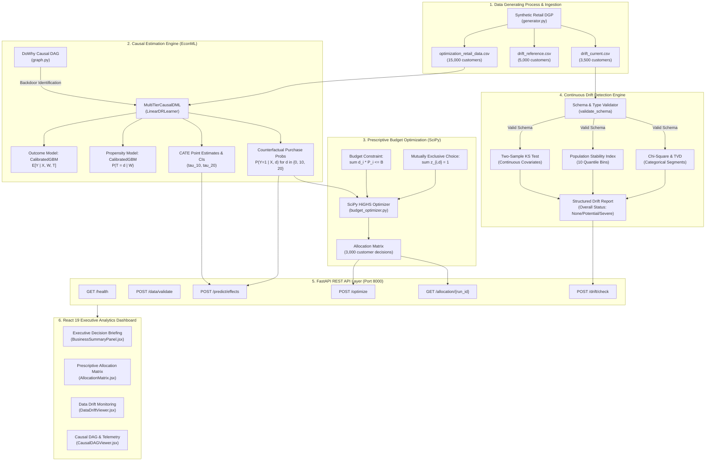

# EconoCasual System Architecture Specification

**Project:** EconoCasual: Dynamic Pricing via Double Machine Learning  
**Version:** 1.0.0 (Production Release)  
**Authors:** Senior AI/ML Architecture Team  
**Date:** November 3, 2026

---

## 1. High-Level System Architecture

EconoCasual is a production-grade prescriptive causal AI platform designed to estimate customer-level price elasticity, resolve marketing selection confounding, optimize promotional discount allocations under marketing budget caps, and monitor incoming customer cohorts for data drift.

---

## 2. Core Subsystems

### 2.1 Causal Identification & Machine Learning Engine
- **DoWhy Causal DAG:** Formalizes structural assumptions and mathematically proves non-parametric backdoor identification conditioning on pre-treatment confounders $W = \{\text{age}, \text{loyalty\_score}, \text{previous\_purchases}, \text{customer\_segment}, \text{campaign\_channel}\}$.
- **Strict Anti-Leakage Quarantine:** Quarantines post-treatment mediators (`discount_amount`), downstream revenue (`order_value`), and identifiers (`customer_id`) from baseline feature matrices.
- **EconML Multi-Tier Double Machine Learning:** Fits `LinearDRLearner` with 5-fold cross-fitting, evaluating discrete discount levels $d \in \{0, 10, 20\}$ against the full-price baseline ($0$).

### 2.2 Prescriptive SciPy Budget Optimization Engine
- **Mathematical Model:** Multiple-Choice Knapsack Problem (MCKP) formulated as a Binary Integer Linear Program (BILP).
- **Objective Function:** Maximize expected contribution margin:
  $$\max \sum_{i=1}^N \sum_{d \in \{0, 10, 20\}} z_{i,d} \cdot \left[ (\text{price}_i \cdot \text{margin}_i - d) \cdot \hat{P}(Y=1 \mid X_i, d) \right]$$
- **Budget Constraint:**
  $$\sum_{i=1}^N \sum_{d \in \{10, 20\}} z_{i,d} \cdot \left[ d \cdot \hat{P}(Y=1 \mid X_i, d) \right] \le B$$
- **Solver Engine:** `scipy.optimize.milp` backed by the high-performance C++ HiGHS solver.

### 2.3 Continuous Data Drift & Monitoring Engine
- **Pre-Statistical Schema Validation:** Isolates schema corruptions, missing columns, type coercion failures, and out-of-range bounds before running hypothesis tests.
- **Two-Sample Kolmogorov-Smirnov Test:** Identifies empirical CDF divergence across continuous covariates.
- **Population Stability Index (PSI):** Quantifies distributional shift across 10 baseline quantile bins with Laplace smoothing.
- **Total Variation Distance (TVD) & Chi-Square:** Tracks categorical shifts and detects newly emerging or disappearing customer segments.
- **Causal Safeguard:** Enforces the methodological distinction between Covariate Shift ($P(X)$) and Concept Drift ($P(Y \mid X, T)$), prohibiting unmonitored automated retraining.

### 2.4 FastAPI REST API Layer
- Fully asynchronous REST API exposing health checks, data validation, CATE inference, MILP optimization, historical allocation retrieval, and drift checking.
- Powered by Pydantic v2 schemas, strict type enforcement, explicit CORS preflight handling, and structured error responses.

### 2.5 React 19 Executive Dashboard
- Modern, responsive SPA powered by Vite 8 and React 19.
- Four primary operating modes:
  1. **Executive Decision Briefing:** Deterministic natural-language synthesis for commercial leaders.
  2. **Prescriptive Allocation Matrix:** Sortable, searchable 3,000-customer policy table with configurable budget slider and strategy benchmarks.
  3. **Data Drift & Monitoring:** Live statistical telemetry, cohort comparison switcher, and comparative distribution charts.
  4. **Causal DAG & Telemetry:** Structural graph visualization and exploratory marketing telemetry.

---

## 3. Technology Stack & Dependencies

| Component | Library / Framework | Version | Function |
| :--- | :--- | :--- | :--- |
| **Language** | Python | 3.11.9 | Core runtime |
| **Causal Modeling** | EconML | 0.17.0 | Double Machine Learning (LinearDRLearner) |
| **Causal DAGs** | DoWhy | 0.14.0 | Back-door identification & DAG formalization |
| **Optimization** | SciPy | 1.14.0+ | Mixed-Integer Linear Programming (HiGHS) |
| **REST API** | FastAPI | 0.115.0+ | Production asynchronous API layer |
| **ASGI Server** | Uvicorn | 0.32.0+ | Production web server |
| **Frontend Core** | React | 19.0.0 | User interface components & state management |
| **Build Tool** | Vite | 8.3.4 | Frontend bundling & hot module replacement |
| **Visualization** | Plotly / Lucide | 2.35.0 / 0.453 | Interactive telemetry and iconography |
| **Testing** | Pytest / Vitest | 9.1.1 / 5.0.5 | Multi-framework unit and integration testing |

