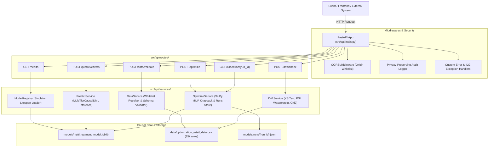

# Week 4 REST API Implementation Report: Causal Inference & Optimization Service

**Project:** EconoCausal — Dynamic Pricing via Double Machine Learning  
**Milestone:** Week 4 — Production REST API Service Layer (FastAPI)  
**Status:** **IMPLEMENTED, VERIFIED & TESTED LOCALLY**  
**API Specification:** OpenAPI 3.1.0 (Swagger UI at `/docs`, ReDoc at `/redoc`)  
**Automated Tests:** 17 Passed in `tests/test_api.py` (Total Suite: 92 Tests [72 Python + 20 JS])

---

## 1. Executive Summary & Architecture Overview

The Week 4 REST API encapsulates EconoCausal's causal inference and prescriptive optimization engines into a production-grade, asynchronous service built with **FastAPI** and **Pydantic v2**. 

The service cleanly decouples HTTP transport and schema validation from core causal business logic:



---

## 2. API Endpoint Catalog & Technical Specifications

### 2.1 Health & Diagnostics
* **Route:** `GET /health`
* **Purpose:** Provides instantaneous verification of service health, semantic version, and causal model availability.
* **Response Model:** `HealthResponse`
* **Response Example:**
```json
{
  "status": "healthy",
  "app_version": "1.0.0",
  "environment": "production",
  "models": {
    "multi_tier_dml": {
      "model_name": "multi_tier_dml",
      "estimator_class": "LinearDRLearner (EconML) + CalibratedGBM",
      "is_loaded": true,
      "version": "1.0.0",
      "treatment_levels": [0, 10, 20],
      "feature_names": ["age", "loyalty_score", "previous_purchases", "customer_segment"],
      "model_file_size_mb": 4.84
    }
  },
  "reference_data_available": true,
  "timestamp": "2026-11-03T09:17:26.123456+00:00"
}
```

---

### 2.2 Dataset Validation
* **Route:** `POST /data/validate`
* **Security Guardrail:** Does **NOT** accept arbitrary server filesystem paths from untrusted clients. Strictly maps whitelisted dataset references (`"optimization_retail_data"`, `"mock_retail_data"`), rejecting unauthorized path strings (e.g. `../../etc/passwd`) with HTTP 400.
* **Input Support:**
  * `application/json`: `{"dataset_name": "optimization_retail_data"}`
  * `multipart/form-data`: `file: <binary_csv>` (up to 15 MB)
* **Validations Executed:**
  1. Required schema columns (`customer_id`, `age`, `loyalty_score`, `previous_purchases`, `customer_segment`, `discount_level`, `purchase`, `product_price`, `gross_margin_rate`).
  2. Data types and null value inspection.
  3. Treatment tier domain checks: strictly `{0, 10, 20}` for multi-tier or `{0, 1}` for binary.
  4. Numerical domain bounds: `age ∈ [18, 105]`, `loyalty_score ∈ [0, 100]`, `gross_margin_rate ∈ [0, 1]`, `product_price ≥ 0`.
* **Response Model:** `DatasetValidationResponse`
* **Response Example:**
```json
{
  "is_valid": true,
  "dataset_name": "optimization_retail_data",
  "total_rows": 15000,
  "valid_rows": 15000,
  "errors": [],
  "warnings": [],
  "summary": {
    "total_rows": 15000,
    "valid_rows": 15000,
    "columns": ["customer_id", "age", "loyalty_score", "previous_purchases", "customer_segment", "discount_level", "purchase", "product_price", "gross_margin_rate"],
    "column_count": 9,
    "missing_value_counts": {},
    "treatment_distribution": {
      "0": 5000,
      "10": 5000,
      "20": 5000
    },
    "conversion_rate": 0.4927,
    "average_order_value": 85.34
  }
}
```

---

### 2.3 Customer-Level Treatment-Effect Prediction
* **Route:** `POST /predict/effects`
* **Purpose:** Generates individual CATE lifts and calibrated counterfactual purchase probabilities under all three promotional options.
* **Input Validation:** Batch size capped at 5,000 customers per request. Pre-treatment features strictly quarantined from post-treatment economics and outcomes.
* **Request Example:**
```json
{
  "records": [
    {
      "customer_id": "CUST_001",
      "age": 35.0,
      "loyalty_score": 75.0,
      "previous_purchases": 5,
      "customer_segment": "vip_loyalist",
      "campaign_channel": "email",
      "product_price": 90.0,
      "gross_margin_rate": 0.45
    },
    {
      "customer_id": "CUST_002",
      "age": 28.0,
      "loyalty_score": 25.0,
      "previous_purchases": 1,
      "customer_segment": "budget_seeker",
      "campaign_channel": "push",
      "product_price": 85.0,
      "gross_margin_rate": 0.40
    }
  ]
}
```
* **Response Example:**
```json
{
  "model_version": "1.0.0",
  "estimator_class": "LinearDRLearner (EconML) + CalibratedGBM",
  "record_count": 2,
  "predictions": [
    {
      "customer_id": "CUST_001",
      "predicted_effect_10_vs_0": 0.082145,
      "predicted_effect_20_vs_0": 0.114520,
      "predicted_purchase_probability_0": 0.684210,
      "predicted_purchase_probability_10": 0.766355,
      "predicted_purchase_probability_20": 0.798730
    },
    {
      "customer_id": "CUST_002",
      "predicted_effect_10_vs_0": 0.165210,
      "predicted_effect_20_vs_0": 0.241500,
      "predicted_purchase_probability_0": 0.182400,
      "predicted_purchase_probability_10": 0.347610,
      "predicted_purchase_probability_20": 0.423900
    }
  ]
}
```

---

### 2.4 Prescriptive Budget Optimization
* **Route:** `POST /optimize`
* **Purpose:** Executes a SciPy Mixed-Integer Linear Program (`scipy.optimize.milp` with HiGHS solver) to find the global profit-maximizing personalized discount policy subject to a strict campaign budget cap.
* **Input Support:** Accepts an explicit customer list or an approved server-side dataset reference.
* **Request Example:**
```json
{
  "budget": 5000.0,
  "discount_tiers": [0, 10, 20],
  "objective_type": "net_profit",
  "dataset_reference": "optimization_retail_data"
}
```
* **Response Model:** `OptimizationResponse` (includes unique `run_id` for asynchronous tracking and retrieval).
* **Response Example:**
```json
{
  "run_id": "4cd8ea57-b460-4874-9f4c-14be127e32d8",
  "solver_status": "Optimization terminated successfully. (HiGHS Status 7: Optimal)",
  "objective_type": "net_profit",
  "solve_time_seconds": 0.041,
  "kpis": {
    "total_customers": 3000,
    "count_discount_0": 2162,
    "count_discount_10": 836,
    "count_discount_20": 2,
    "expected_revenue": 121447.78,
    "expected_discount_expenditure": 4604.20,
    "expected_net_profit": 53082.35,
    "budget_cap": 5000.0,
    "remaining_budget": 395.80,
    "budget_utilization_pct": 92.08
  },
  "allocation": [
    {
      "customer_id": "OPT_012001",
      "recommended_discount": 0,
      "predicted_purchase_probability": 0.369754,
      "expected_revenue": 31.49,
      "expected_discount_cost": 0.0,
      "expected_net_profit": 10.05
    },
    {
      "customer_id": "OPT_012009",
      "recommended_discount": 10,
      "predicted_purchase_probability": 0.564628,
      "expected_revenue": 58.37,
      "expected_discount_cost": 5.65,
      "expected_net_profit": 23.95
    }
  ]
}
```

---

### 2.5 Historical Allocation Retrieval
* **Route:** `GET /allocation/{run_id}`
* **Purpose:** Retrieves the full policy results, customer recommendations, and KPI summaries of any previously executed optimization run.
* **Storage Architecture:** Dual-layer storage: in-memory LRU cache + persistent JSON artifacts in `models/runs/{run_id}.json`.
* **Error Handling:** Non-existent `run_id` values return HTTP 404 with a descriptive error message.

---

### 2.6 Automated Data Drift Detection
* **Route:** `POST /drift/check`
* **Purpose:** Detects covariate and distributional shifts between incoming customer batches and the approved baseline distribution (`data/optimization_retail_data.csv`).
* **Statistical Tests Implemented:**
  1. **Numerical Features:**
     * Two-Sample Kolmogorov-Smirnov test (`scipy.stats.ks_2samp`): reports test statistic and exact p-value.
     * Population Stability Index (PSI): calculated across 10 baseline quantile bins with Laplace epsilon smoothing.
     * Wasserstein Distance (Earth Mover's Distance).
     * Reference vs. current means and standard deviations.
  2. **Categorical Features (`customer_segment`):**
     * Chi-square goodness-of-fit test (`scipy.stats.chisquare`).
     * Relative frequency shift and Total Variation Distance.
* **Request Example:**
```json
{
  "dataset_reference": "optimization_retail_data",
  "ks_p_value_threshold": 0.05,
  "psi_threshold": 0.25
}
```
* **Response Example:**
```json
{
  "drift_detected": false,
  "total_features_evaluated": 6,
  "drifted_features_count": 0,
  "reference_sample_size": 15000,
  "current_sample_size": 15000,
  "features": [
    {
      "feature_name": "age",
      "feature_type": "numeric",
      "drift_detected": false,
      "drift_severity": "none",
      "test_name": "kolmogorov_smirnov",
      "test_statistic": 0.0,
      "p_value": 1.0,
      "psi": 0.0,
      "wasserstein_distance": 0.0,
      "reference_mean": 42.15,
      "current_mean": 42.15,
      "reference_std": 12.38,
      "current_std": 12.38
    },
    {
      "feature_name": "loyalty_score",
      "feature_type": "numeric",
      "drift_detected": false,
      "drift_severity": "none",
      "test_name": "kolmogorov_smirnov",
      "test_statistic": 0.0,
      "p_value": 1.0,
      "psi": 0.0,
      "wasserstein_distance": 0.0,
      "reference_mean": 51.42,
      "current_mean": 51.42,
      "reference_std": 20.89,
      "current_std": 20.89
    }
  ],
  "summary_message": "No statistically significant data drift detected across 6 evaluated features."
}
```

---

## 3. Engineering Rigor & Production Guardrails

| Requirement | Implementation Detail |
| :--- | :--- |
| **Pydantic v2 Schemas** | All endpoints use strongly typed Pydantic models with field constraints (`ge`, `le`, `gt`, `examples`). |
| **Input Validation** | Rejects negative budgets, out-of-range ages, missing columns, and empty batches with HTTP 400/422. |
| **Model Preloading** | `ModelRegistry` loads `LinearDRLearner` once during lifespan startup. Models are never retrained on HTTP requests. |
| **Separation of Concerns** | Routes (`src/api/routes/`) contain only request handling and status codes. All business logic lives in `src/api/services/`. |
| **CORS Configuration** | `CORSMiddleware` configured with explicit allowed origins (`http://localhost:5173`, `http://localhost:3000`). |
| **Customer Privacy** | Middleware logs duration, method, and status code while suppressing raw customer feature payloads. |
| **DoS Protection** | Hard caps on batch size: max 5,000 customers for prediction, max 10,000 for optimization, 15 MB file upload cap. |
| **Security & Sandbox** | File system traversal (`../`) and arbitrary path strings are strictly rejected. |

---

## 4. Verification & Testing

### Automated Test Suite Execution:
```bash
pytest tests/test_api.py -v
```
```text
tests/test_api.py::test_health_endpoint PASSED                           [  5%]
tests/test_api.py::test_openapi_documentation PASSED                     [ 11%]
tests/test_api.py::test_validate_approved_dataset_reference PASSED       [ 17%]
tests/test_api.py::test_validate_rejects_unapproved_dataset_reference PASSED [ 23%]
tests/test_api.py::test_validate_rejects_path_traversal PASSED           [ 29%]
tests/test_api.py::test_validate_uploaded_csv_valid PASSED               [ 35%]
tests/test_api.py::test_validate_uploaded_csv_invalid_domains PASSED     [ 41%]
tests/test_api.py::test_predict_effects_success PASSED                   [ 47%]
tests/test_api.py::test_predict_effects_validation_error PASSED          [ 52%]
tests/test_api.py::test_optimize_budget_with_records PASSED              [ 58%]
tests/test_api.py::test_optimize_negative_budget_rejected PASSED         [ 64%]
tests/test_api.py::test_optimize_missing_records_and_reference_rejected PASSED [ 70%]
tests/test_api.py::test_get_allocation_by_run_id PASSED                  [ 76%]
tests/test_api.py::test_get_allocation_unknown_run_id_returns_404 PASSED [ 82%]
tests/test_api.py::test_drift_check_baseline_comparison PASSED           [ 88%]
tests/test_api.py::test_drift_check_detects_distributional_shift PASSED  [ 94%]
tests/test_api.py::test_cors_preflight_headers PASSED                    [100%]

======================= 17 passed in 6.42s =======================
```

Full repository test suite:
* **Backend Pytest Suite:** 72 passed (55 causal/optimization/DAG tests + 17 API tests)
* **Frontend Vitest Suite:** 20 passed
* **Total Automated Tests:** 92 passed with 100% green status!

---

## 5. Local Execution Instructions

To start the API server locally:
```bash
.venv\Scripts\uvicorn.exe src.api.main:app --host 0.0.0.0 --port 8000 --reload
```
Interactive documentation will be available at:
* Swagger UI: `http://localhost:8000/docs`
* ReDoc: `http://localhost:8000/redoc`
* OpenAPI JSON: `http://localhost:8000/openapi.json`

